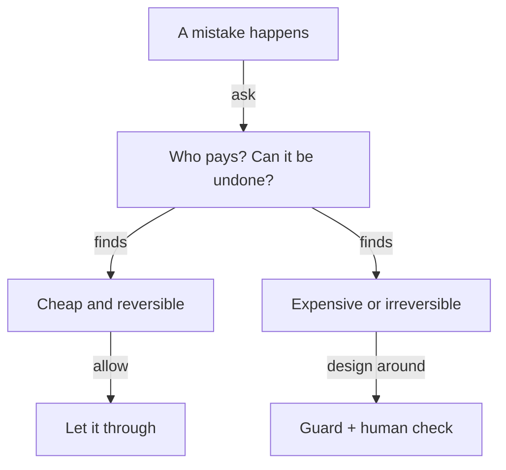

**The idea in one line:** mistakes have different prices, so find the most expensive one and build the system around stopping it.

Any system that uses a model will be wrong sometimes. Pretending otherwise is the fastest way to build something dangerous. The useful question is which wrongness costs you, and how much.

An **error cost** is what a particular mistake costs when it happens, in money, time, trust, or harm. Error costs are lopsided. Two mistakes can look identical in an accuracy score and differ wildly in consequence:

- Marking a harmless posting "unknown location" costs a minute of someone's patience.
- Telling an employer that a candidate works at their rival, when they do not, can end a relationship.

You cannot make the whole system perfect. So find the single most expensive mistake and design around preventing that one. Everything else can be allowed to be a little wrong.

Here is the analogy. A pharmacy is full of small errors nobody loses sleep over: a misspelled vitamin label, a receipt printed twice. A wrong pill handed to the wrong patient is a different category.

Pharmacies do not work equally hard at everything. They put real controls, a second pair of eyes and a name check at the counter, on the one step that cannot be undone.

> Put your controls on the mistake that costs the most and cannot be undone. Let the cheap ones be a little wrong.

## Real-world example: two companies, one name

Our system links jobs to the companies that posted them. Two real companies we came across had near-identical names. They were separate businesses, with different people and different openings.

Our matching came close to treating them as one. Jobs from one company would have appeared under the other's name. Anything built on top, like outreach that mentions the company, would have carried the error forward.

We caught it before it spread. What we did next is the part worth copying. We did not make name matching smarter in general.

We named the expensive mistake: making a claim about a company before we are sure which company it is. Then we added a **name-confirmation guard** that blocks any company-level claim until the identity is confirmed. Matching can stay approximate. Claims cannot.

The cost was friction. The guard sometimes holds back something that was correct, and a person has to look. We accept that gladly. A slow confirmation is a small, visible price. A wrong claim about a real company is a large, hidden one.

## See it yourself (2 minutes)

Open any AI chat and paste this:

> I'm building a system that reads job postings and tags them. List
> eight different mistakes it could make. For each one, tell me who pays
> for it (me, the user, a third party), how bad it is, and whether it can
> be undone. Then tell me which single mistake I should design the whole
> system around preventing.

Compare its ranking with your gut. Often the mistake you were worrying about is cheap, and the one you had not thought of can hurt someone else.

## What this means when you build

Before you build anything in Project 1, you name your expensive mistake in one written sentence, and say who pays for it. Your design follows from that sentence:

- where a human checks
- what the system refuses to claim
- which errors you let through on purpose

A single accuracy number hides the lopsidedness, so you report the expensive mistake separately. A system honest about which errors it can afford is easier to trust than one that claims it makes none.

## Check yourself

You can afford exactly one guard in a job-to-company matching system. Do you guard against "marked a job's location as unknown" or "claimed a job belongs to the wrong company"? Say what the guard blocks.

Decide on your answer, then open

Guard the wrong-company claim. The unknown location costs a minute of patience, while a wrong company claim can reach real people in outreach and damage a relationship. In the war story the guard blocks any company-level claim until the company's identity is confirmed, even if that sometimes holds back something correct.

