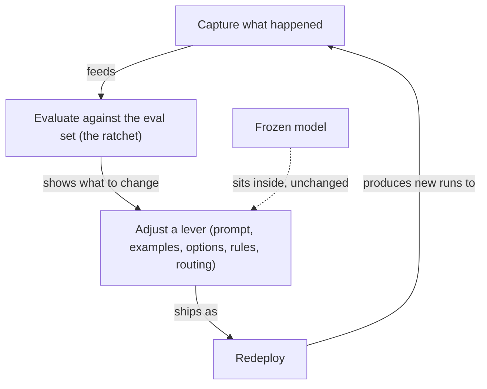

**The idea in one line:** the model never learns from your corrections. The
system around it does, if you build the loop.

Tell a model it got something wrong and it apologises and fixes the answer.
Start a fresh conversation and the mistake is back.

The model's knowledge lives in billions of numbers called **weights**, set
once during training and then frozen. Your corrections never touch them. You
are consulting a finished book, not teaching a student.

That is worth being glad about. A model that rewrote itself daily could not
be tested on Monday and promised on Tuesday. Frozen weights are why a model
can be evaluated, trusted and budgeted at all.

So improvement comes from the system you build around the model. Every
piece that is yours to change is a **lever**:

- the prompt and the worked examples in it
- the lists of allowed options
- the rules in code
- the skills your agent can load
- the routing that sends easy work to a cheap model and hard work to a
  stronger one

The loop has four steps: capture what happened, evaluate it, adjust one
lever, redeploy. Then go round again.

The **eval set** keeps this honest. It is a collection of examples with
known right answers that you never tune against by hand, and it works like a
**ratchet**, a toothed wheel that turns one way.

Without it, a prompt change is a coin flip: better on the cases you
remembered, worse on the ones you forgot. That is **drift**. With it, each
change either raises the score and stays, or lowers it and is undone.

Here is the analogy. An airline's pilots do not get smarter between
flights, and the aircraft does not redesign itself. Yet flying keeps getting
safer, because every incident is investigated and a line is added to the
checklist. The pilot is the frozen model. The checklist is the system.

> Safety lives in the checklist, and each line in it can be dated to the day
> something went wrong.

Changing the weights themselves, through fine-tuning, is out of this
course's scope. Every improvement here happens outside the model.

## Real-world example: the system that improved around a frozen model

For months, the model behind our enrichment pipeline did not change. The
system around it got better anyway, and each improvement traces to a dated
failure.

- A dry run once burned real money, because "dry" had quietly meant
  "cheaper" instead of "free". Now a dry run makes zero model calls, and a
  test enforces it.
- One night an account problem produced 8,402 errors, because the batch kept
  going after every failure was the same failure. Now account errors halt
  the batch.
- A rule once matched about fifty times more rows than we expected, and we
  found out after paying for them. Now the pipeline counts before it
  spends.

Near-misses became guard tests. Each failure was one click of the
ratchet, and the eval set is how we know the clicks were improvements.

## See it yourself (2 minutes)

Open any AI chat. Ask a question you know the answer to, then tell it
that it is wrong. Watch it apologise. Then open a brand new conversation and
ask the identical question.

Now ask the second chat:

> Do you remember the correction I made in my other conversation? If
> not, explain in plain words why you can't, and list three things
> outside you that I could change so a mistake like that gets caught
> next time.

The three things it lists are your levers.

## What this means when you build

In Project 2 you will run your pipeline against an eval set and report a
score. From then on you own a loop.

- Every failure you find should leave behind one lever pulled: a rule, an
  example, a guard test.
- Write down the date and the score before and after.

By the capstone, that list is the evidence your system learns even though
your model never does.

## Check yourself

A dry run once cost us real money, and the model behind the pipeline had not changed at all. What got fixed, where did the fix live, and what lets you know it was an improvement and not just a change?

Decide on your answer, then open

The fix lived in the system around the model: a rule that a dry run makes zero model calls, enforced by a test. That is a lever pulled outside the frozen model. The eval set, scored the same way before and after, is how you know each change raised the score instead of merely changing behaviour.

