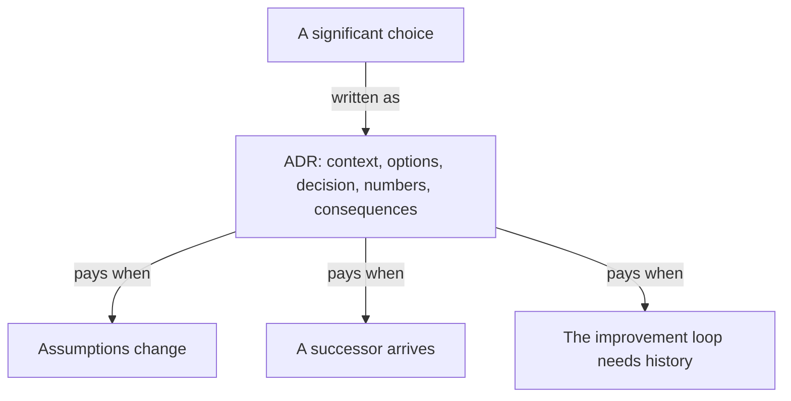

**The idea in one line:** a log shows what the system did. A decision trace
records why you chose it over the alternatives.

A cousin you'll meet in Project 4 is the **audit trail**, the record of what
happened and who approved it. It answers "what happened, and was it allowed?"

A **decision trace** answers "why this option, and not the others?" It
records the alternatives, the evidence that tipped the choice, and what you
assumed at the time.

> A log shows the system you picked. It cannot show the three you rejected
> or the reason.

The standard shape in software is the **ADR**, short for architecture
decision record. One page, five parts, easy to copy:

1. **Context.** What problem forced a decision, and what constraints applied.
2. **Options considered.** Every serious alternative, including doing
   nothing.
3. **Decision.** What you chose, in one plain sentence.
4. **Numbers.** The measurements the choice rests on, and how to rerun them.
5. **Consequences.** What gets better, what gets worse, and what you will
   watch for.

Here is the analogy. A mountaineering expedition keeps a route log. It does
not only say "we summited by the north ridge." It says the south face was
dropped because of avalanche risk, and that the team turned back once at the
col because of weather.

The next expedition reads the log, checks whether conditions changed, and
follows the route or has a good reason not to. A decision trace is the route
log for your system.

Traces pay off three times:

- **When assumptions change.** A choice that was right under last quarter's
  prices or limits may be wrong now, and the trace says which assumption to
  recheck.
- **When someone new arrives.** A teammate, or an agent starting a fresh
  session with no memory, inherits your judgement and not only your code.
- **In the improvement loop** from the previous note. The loop needs to know
  what was tried and what happened.

## Real-world example: the one-point trade we wrote down

We moved a classification task, picking answers from a fixed list, from a
frontier model to a small one. On our **held-out set**, examples kept aside
and never used for tuning, accuracy fell by about one point. Cost fell
roughly eight times.

We took that trade, then did the part that is easy to skip. We wrote it down
as an ADR: the context, the alternatives, the two numbers, the reasoning for
accepting a one-point loss, and an escalation rule that sends the cases the
small model handles worst back to the stronger one.

Months later, anyone can read the reasoning in a minute or rerun the
numbers. When a newer small model appears, "should we move again?" is a
fifteen-minute exercise. Without the page, it would have been an argument.

## See it yourself (2 minutes)

Pick a real decision you made recently, such as which tool you picked.
Paste it into any AI chat and ask:

> Interview me, one question at a time, until you can write an
> architecture decision record for this decision: context, options
> considered, decision, numbers, consequences. Push back whenever I
> give a reason without evidence.

Notice how often you cannot name the second option. That is what a missing
trace feels like from the inside.

## What this means when you build

Before each build you write a prediction sheet: what you expect the system
to cost, how accurate it will be, and why. That sheet is a decision trace
about yourself, and the gap to the real numbers is where you learn.

From Project 2 on, keep one ADR per significant choice in your repo. A
reviewer should be able to answer "why is it built this way?" without asking
you.

## Check yourself

Moving to the small model cut a roughly $800 monthly bill by about eight times and cost about one point of accuracy. What is the new bill, and what must the decision record hold besides those two numbers?

Decide on your answer, then open

About $100 a month. The record should also hold the context, the alternatives considered, the reasoning for accepting the one-point loss, and the escalation rule that sends the hardest cases to the stronger model. With those written down, "should we move to the newer model?" becomes a fifteen-minute rerun of known numbers.

