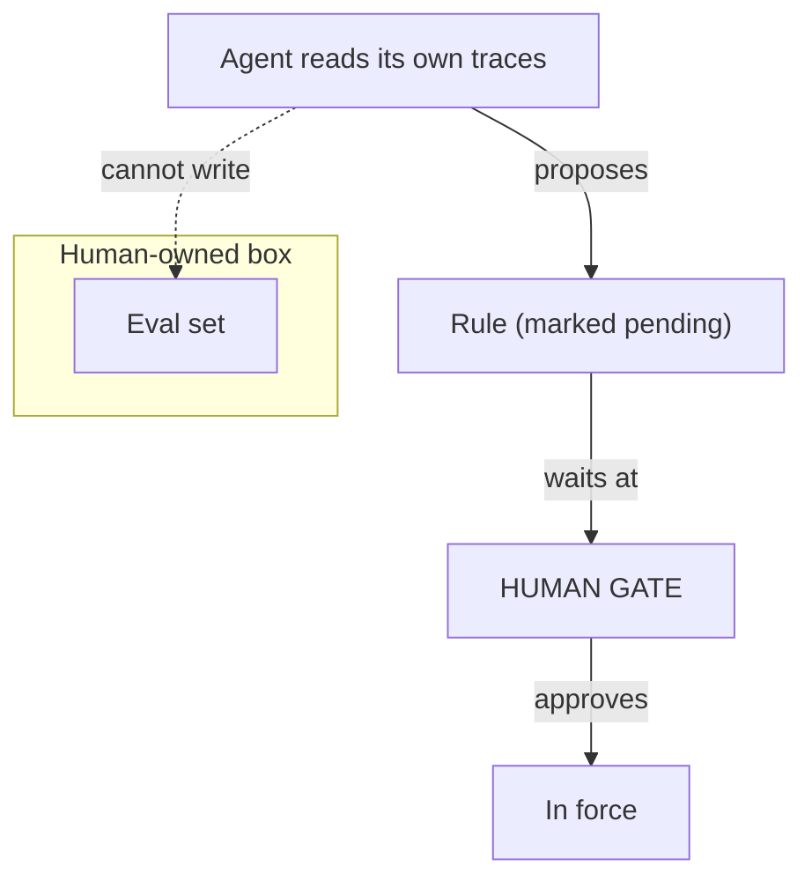

**The idea in one line:** the agent may propose changes to itself. A person
approves them, and the eval set stays out of the agent's reach.

Once your system captures decision traces, a tempting step appears. The
agent reads its own history, notices patterns in its failures, and writes
down changes: a new rule, a better prompt example, a note for its memory.
It sees hundreds of cases a human never will.

The question is not whether the agent may propose. It should. The question
is what happens next.

Earlier in this course, an agent that wants to send an email or move money
meets an **approval gate**, so a person decides before anything reaches the
outside world. A change to the agent's own rules is an action too, one that
takes effect on every future run. It deserves the same gate, pointed inward.

> The agent proposes, a person approves, and only then does the change enter
> force.

The second half is about measurement. The **eval set**, the examples with
known right answers that tell you whether a change helped, has to stay in
human hands.

If the agent can edit its own exam, or write rules shaped to the exam it can
see, it grades its own homework. Scores climb and mean nothing. This is an
old trap: when the measure becomes the target, it stops measuring.

Here is the analogy. In a newsroom, a reporter pitches stories, and good
reporters pitch constantly. An editor decides which ones run. The
fact-checker reports to neither, because reporters who check their own facts
print their own errors with confidence.

The reporter is the agent, the editor is the approval gate, and the
fact-checker is your human-owned eval set. Each role works because the
others are separate.

## Real-world example: rules that wait for approval

We mined style rules from real replies our operators had actually sent, and
the pipeline produced a draft set of rules from them.

It did not go straight into force. The mined draft carries a review-pending
marker, and each rule stays inactive until the operator approves it. The
system proposes its own improvement, and a person gates it.

A wrong rule is caught by someone reading it, not by a customer receiving
an email shaped by it.

## See it yourself (2 minutes)

Open any AI chat and paste a few of your own messages or notes. Ask:

> Based on this writing, propose five rules describing my style. For
> each one, give the evidence from the text, and tell me which rule you
> are least sure about. Don't apply anything. Just list them for my
> review.

Now do the human half. Cross out one rule you disagree with, and rewrite one
in your own words. That edit is the approval gate doing its job, and the rule
that survives is better than the one proposed.

## What this means when you build

In Week 8, you will give your agent a way to propose improvements
from its own traces, and build the gate in front of them.

- Every proposal arrives marked as pending, with the evidence beside it.
- Nothing becomes active until you approve it.
- Your eval set lives where the agent cannot write, and your write-up says
  so.

Reviewers look for exactly that boundary.

## Check yourself

Your agent mines style rules from real replies and drafts a set. Why does the draft ship with a pending marker, and why must the eval set sit where the agent cannot write?

Decide on your answer, then open

The pending marker keeps each rule inactive until an operator approves it, so a wrong rule is caught by someone reading it, not by a customer receiving an email shaped by it. The eval set must stay out of the agent's reach because an agent that can edit or tune to its own exam grades its own homework, and scores climb while meaning nothing.

