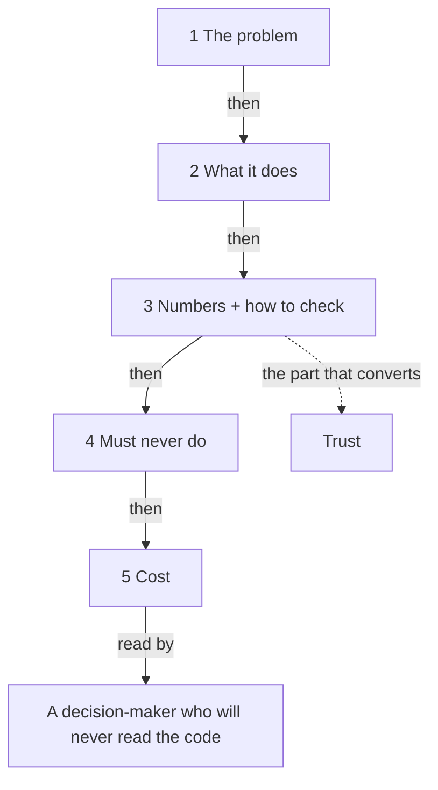

**The idea in one line:** explain your system on one page with the same five
parts every time, so a decision-maker can check it.

The person who approves your system will almost never read the code. They
have four questions: what does this do for me, can I believe it, what could
it get wrong, and what does it cost.

If you don't answer those in about a page, an excellent system can still go
unused.

The format that answers them is a **solution memo**, a short written document
for a decision-maker. A good one has the same five parts every time. That
repetition is the point, because readers learn where to look.

Here's the analogy. A nutrition label doesn't describe how the food was
cooked. It lists a fixed set of facts in a fixed order, in units anyone can
compare, and you can read three of them in ten seconds. Nobody has to trust
the cook. Your memo is the label on your system.

Here is the template. Copy it into your project.

> **1. The problem.** One or two sentences, in the stakeholder's own
> words. What is slow, costly or error-prone today?
>
> **2. What the system does.** The process in plain steps: what goes in,
> what comes out, who sees it. No technology words they didn't use first.
>
> **3. The numbers, and how to check them.** Each claim paired with how
> the reader can verify it themselves: where to look, what to count.
>
> **4. What it must never do.** The hard limits, stated flatly. What it
> won't send, won't change, won't decide alone.
>
> **5. What it costs.** Per unit of work, plus what happens if usage
> doubles. Relative to the manual way.

Part 3 does the work, because adjectives ask the reader to take your word.

> A claim with no way to check it is an adjective.

Part 4 is the one people most often leave out, and often the one a cautious
reader trusts most.

## Real-world example: seven searches out of eight

Our agency sends clients reports on how their brand shows up when people ask
AI assistants questions. The first reports we could have written were full of
adjectives: strong presence, healthy visibility, good momentum.

Instead each report leads with a fact the reader can verify: "You appear in 7
of 8 searches we ran, and the one you are missing is the broadest one." A
client can run those eight searches in an afternoon. The sentence also names
the gap, which tells the reader we're describing their situation, not selling
them one.

The checkable number converts, and praise does not. The same rule runs
through Deployed, our job board, where pages are banned from hand-typed
numbers: every count renders from the live database, and where there is no
verified number the page says nothing.

## See it yourself (2 minutes)

Tell any AI chat about something you built or could build. Then ask:

> Write a one-page solution memo for this using these five parts: problem,
> what the system does, numbers and how to check them, what it must never
> do, what it costs. Then mark every sentence in part 3 that a reader
> could not verify themselves, and rewrite each so they could.

The rewrite is the exercise: "highly accurate" turns into a count the reader
can reproduce.

## What this means when you build

Every mission ends with a memo like this, written for a
stakeholder who has never seen your code.

- Start it at the beginning, not the end. Parts 1 and 4 can be drafted before
  you build anything, and writing them first tells you what the system has to
  be.
- Fill part 3 only with numbers your own harness produced, and next to each
  one say how the reader can reproduce it.

## Check yourself

Rewrite "We have healthy visibility across AI assistants" so a stranger could test it in an afternoon. Which two things must your version contain?

Decide on your answer, then open

A count and the gap, as in "You appear in 7 of 8 searches we ran, and the one you are missing is the broadest." Adjectives cannot be checked, but a client can rerun eight searches. Naming the gap also shows you are describing their situation, not selling.

