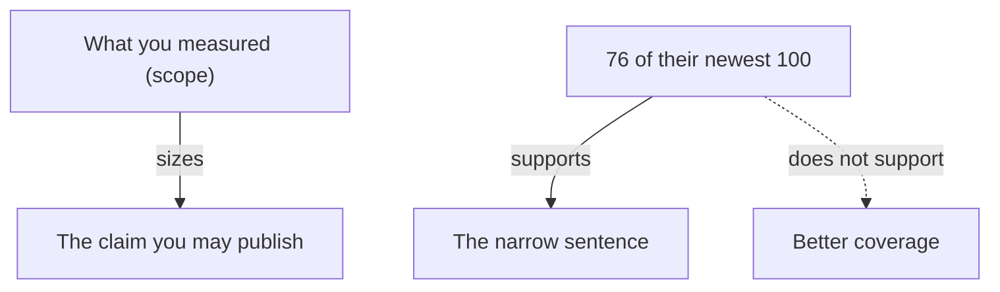

**The idea in one line:** show numbers a reader could reproduce, and claim only
what your measurement actually covers.

A number without a method is a rumour with decimals. The reader remembers
the headline, and the question they ask, aloud or not, is "how do you know?"

The discipline has two halves:

- **Make the number checkable.** Say what was measured, against what, over
  which sample, so the reader could repeat it.
- **Size the claim to the evidence.** Say only what the measurement
  supports. A measurement of a slice supports a statement about that slice,
  and no more.

Here's the analogy. A bridge has a load sign: "Maximum 10 tons." The
engineers could have written "very strong bridge." They wrote a number
because it was tested, it has a unit, and a truck driver can act on it.

They also didn't write "safe for anything", because they tested ten tons,
not everything.

> The sign is useful precisely because it's narrow.

## Real-world example: the honest 76 percent

We wanted to say how good Deployed's job coverage was, and the obvious
benchmark was the biggest competitor in remote job listings. The tempting
sentence was "better coverage". It would have fit on a banner.

We didn't have the evidence for it. What we could measure was narrow: among
the newest remote listings, how many of theirs did we also carry? The answer
was 76%. We also found many listings they lacked. So the defensible
statement was exactly that: we carry 76% of their newest remote listings,
plus many they don't have.

That's what we published. The smaller claim reads less dramatically than a
banner. We took that cost because a stranger can reproduce the narrow claim
with a spreadsheet and an afternoon, and cannot reproduce a broad one.

We specified the scope (newest, remote), the comparison (their listings
against ours), and the number. Anything beyond that we left unsaid.

Notice what 76% does that "better" can't. It tells the reader where we fall
short, which makes the other part, the listings they lacked, believable.
Nobody trusts a source that reports only good news.

## See it yourself (2 minutes)

Paste these three claims into your agent or any AI chat:

> "Our assistant is highly accurate." "Customers love the new search." "We
> beat the leading tool." For each, tell me what I'd need to measure for it
> to be a checkable claim, and rewrite it as a sentence with a number, a
> scope and a method. Then say what the evidence would NOT support, so I
> don't overclaim.

Pay attention to the last part. The "does not support" list is where a
careful presenter lives. If the rewrite still claims too much, push back and
ask it to narrow further.

## What this means when you build

Your Week 3 write-up and your Week 8 presentation both report results, and a sharp
reader will judge you on claim size as well as accuracy. For each number on your slides, write three
things beside it:

- how it was measured
- on what sample
- what it does not tell us

A stakeholder should be able to take your sentence, run your method, and get
roughly your number. When you're unsure how big a claim to make, make the
smaller one and name the bigger one as the next test. It's easier to grow a
claim than to retract one.

## Check yourself

You measured that you carry 76 of a rival's 100 newest remote listings and have 40 more they lack. Can you publish "better coverage", yes or no? What can you say?

Decide on your answer, then open

No. You measured one narrow comparison, so the defensible sentence is "we carry 76% of their newest remote listings, plus many they don't have." It names the scope, the direction and the number, and admitting where you fall short makes the rest believable.

