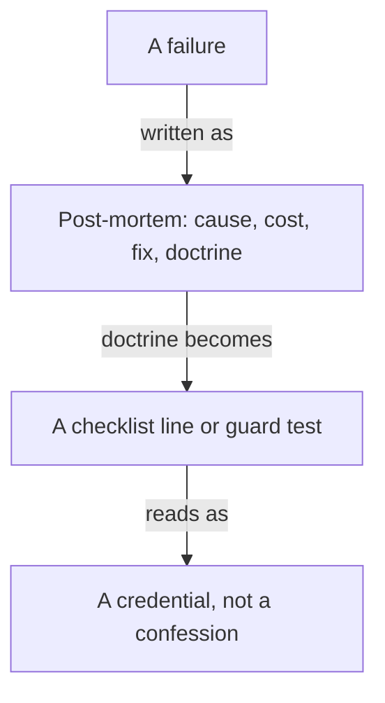

**The idea in one line:** a clean written account of a failure earns more
trust than a record with no failures on it.

At some point your system will do something wrong, and someone will notice.
What you say next shapes how much they trust everything else you've built.

A **post-mortem** is a short written account of a failure, written after it's
fixed. It has four parts:

- **Cause.** What allowed it.
- **Cost.** What it cost.
- **Fix.** What changed.
- **Doctrine.** The rule it left behind.

The point is to find what allowed the failure, not who to blame. A system
that let one person make a mistake will let the next person make it too.

A record with no failures on it could mean skill or a lack of looking.
Someone who can describe exactly what broke, what it cost and why it can't
happen again has shown you how they work when it matters.

> A clean account of a failure works as a credential.

Here's the analogy. Commercial aviation became safe in part because pilots
and airlines report incidents openly, and investigators publish what they
find in a plain, standard shape. Nobody trusts an airline that claims it
never has a near miss. People trust the industry whose near misses are
written down and fixed.

## Real-world example: the dry run that spent money

This is the post-mortem we wrote, in the shape we write them.

**Cause.** Our enrichment pipeline, the program that sends job postings to a
model for classification, has a `--dry-run` flag. A dry run is meant to show
what a run would do without doing it. Ours called the model anyway.

**Cost.** Real money, for about ten minutes, before anyone noticed. The flag
promised a rehearsal and delivered a live run. The money was the smaller
part of the lesson, because the same flag could have been pointed at a much
bigger batch.

**Fix.** A dry run now makes zero model calls. Instead it prints a table of
the estimated cost for each row, so you see the bill before you commit. And
the first log line of a live run says plainly that it is live and states how
many rows it will process.

**Doctrine.** "A dry run makes zero model calls." That sentence is now how we
review any pipeline. A rehearsal that spends money isn't a rehearsal, and a
run that doesn't announce its own size isn't ready.

Notice what the account leaves out: adjectives, excuses and anyone's name.
That plainness is what makes it believable.

## See it yourself (2 minutes)

Pick a real mistake of your own, any size. Give it to any AI chat with:

> Here's a mistake I made: [describe it]. Help me write it up as a
> four-part post-mortem: cause, cost, fix, and the rule it left behind.
> Push back wherever I wrote an excuse, an adjective, or a blame. The
> cause should be something about the system, not about me being careless.

Notice how much shorter the result is than the story you'd tell a friend.
The short version is the credible one.

## What this means when you build

In the Capstone you'll present a system to a stakeholder, and you'll be
expected to include one thing that went wrong while you built it.

- Choose the failure with the best doctrine, the one that changed how you
  work.
- Write it up in the four parts.
- Say what it cost in plain terms, however small.

Catching a mistake while you build costs little. A post-mortem turns that
into a reason to be believed later.

## Check yourself

In our dry-run post-mortem, is "a dry run makes zero model calls" the fix or the doctrine? Why does the difference matter?

Decide on your answer, then open

The doctrine. The fix was the specific change: zero model calls, a printed cost table, and a first log line stating the row count. The doctrine is the sentence reused to review any pipeline, so the lesson outlives this one incident.

