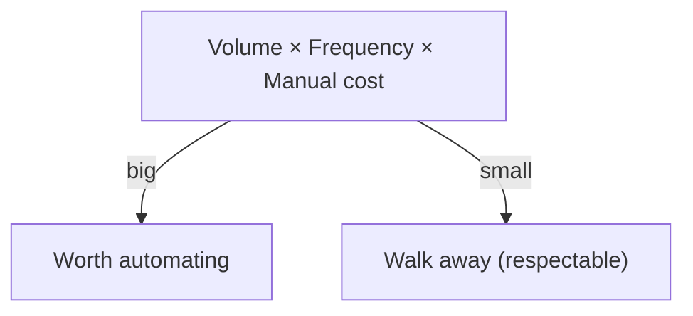

**The idea in one line:** three numbers decide whether a task deserves automation, and walking away is sometimes the right answer.

When someone says "we should use AI for this," your first job is to find out whether they are right. Automation has a cost: someone builds it, checks it, and keeps it running. A task only earns that cost if doing it by hand costs more.

Three numbers settle it:

- **Volume:** how many items there are to process.
- **Frequency:** how often the work comes around (daily, weekly, once a year).
- **Cost of the manual way:** how long a person takes per item, and what that time is worth.

Multiply the three and you have a rough picture of what the problem costs today. If that picture is small, automation has nothing to save.

You also need the nerve to say so. A good engineer sometimes tells a client, "there is not enough repetitive work here to justify a system." A client who hears that will believe you next time you say something is worth building.

Here is the analogy. A farmer facing a dry season does not irrigate every field. She walks them, checks which have the most acres, which crops die fastest without water, and which are near the well.

She waters those. A small corner patch that would need a long pipe for a handful of plants stays dry, and nobody calls that laziness.

> Multiply volume, frequency, and manual cost. If the answer is small, walking away is a respectable result.

## Real-world example: counting demand instead of guessing

Deployed, our job board, also feeds a candidate side. We had to decide which kinds of candidate profiles to source first. The tempting way was to guess: pick a profile that sounds popular, or one a teammate knew well.

We counted instead. The board holds live jobs, so it knows what employers are trying to hire for right now. We counted open positions by role type and sourced the profiles that matched the largest numbers.

The honest limit: live postings measure what employers advertise. That is a good proxy for demand, but it is not what they will pay for or how fast they hire.

So we treated the count as the strongest evidence we had, not as proof. Even so, a count beat a guess on every dimension that mattered. It could be repeated, it could be challenged, and it did not depend on whose opinion was loudest in the room.

## See it yourself (2 minutes)

Open any AI chat and paste this:

> My team spends time on a task. Interview me to decide whether it is
> worth automating. Ask for volume, frequency, and cost per item one
> question at a time. When you have all three, tell me the rough yearly
> cost of doing it manually, and tell me honestly whether it is worth
> automating. If it is not, say so.

Use a real task, like sorting email. Notice when it asks for frequency: the thing that feels exhausting often happens twice a month, and the thing you never noticed happens forty times a day.

## What this means when you build

In Project 1 you start with discovery, before any code. Your mentor skill asks for the three numbers, and it accepts "this is not worth automating" as a real result.

You write down your estimate of the manual cost, so later you can compare what your system saves against a figure you committed to in advance.

If your problem scores low, do not rescue it with enthusiasm. Pick a different one.

## Check yourself

A team sorts 30 invoices a week, 4 minutes each, by a person worth $20 an hour. Roughly what does that cost per year, and would you build a system that costs $5,000 in its first year?

Decide on your answer, then open

30 invoices x 52 weeks x 4 minutes is about 104 hours, or roughly $2,080 a year. At $5,000 in year one the system costs more than the problem, so the honest answer is no, or at least not yet. Saying "not enough repetitive work here" is a respectable result.

