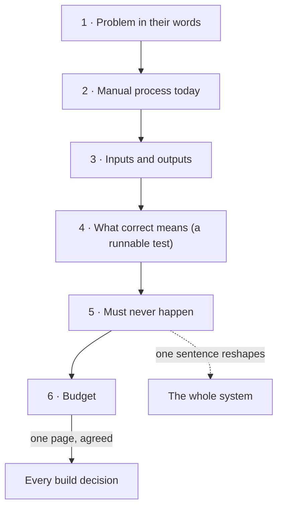

**The idea in one line:** one page with six headings, and one hard constraint, can reshape the whole system you build.

Before you build, you write down what you are building. Not a long document, a single page.

Most failed projects fail because two people carried different pictures of the same system. A one-pager forces the pictures into the open while changing them is still cheap.

A **requirement** is a statement of what the system must do, and must never do, in terms the person paying for it can read and confirm. A good one-pager has six parts:

1. **The problem in the stakeholder's words.** A **stakeholder** is anyone who cares how this turns out. Quote them. Do not translate yet.
2. **The current manual process.** What happens today, step by step, and who does it.
3. **Inputs and outputs.** What goes in, in what form, and what must come out.
4. **What "correct" means.** A test someone could run. "Good summaries" is a wish. "Ninety of a hundred reviewed rows match a human's answer" is a test.
5. **What must never happen.** The expensive mistake from the last note, in plain words.
6. **The budget.** Time, money, and how much of each you spend per run.

The fifth heading is the strange one, because it is a negative. It is also the most powerful.

Here is the analogy. A doctor's referral note to a specialist is short on purpose: the complaint, what has been tried, what is being asked, and what to avoid, such as a known allergy. The allergy line is one sentence, and every decision the specialist makes bends around it.

> One hard constraint, written in one sentence, can reshape the whole system.

## Real-world example: the sentence that rebuilt a system

Our outreach system writes to companies about roles on the board. One line in a draft became a rule. We may only say "we have pre-vetted candidates for this role" when that is literally true for that specific job, on that specific day.

That one sentence demanded a lot:

- We needed to know, per job, whether we really had matching candidates.
- We needed the posting to still be open, so it is re-verified live the same day we send.
- We needed the claim attached to the job, not to the company in general.

A sentence of honesty reshaped the data we keep, the checks that run before sending, and the wording we allow.

An early version would have been a template with a friendly, vaguely true line. The stricter version cost real work and some emails that never went out. We would make the same trade again.

## See it yourself (2 minutes)

Open any AI chat and paste this:

> I want to automate something at work. Interview me to fill in a
> requirement one-pager with these six headings: the problem in my
> words, the current manual process, inputs and outputs, what
> "correct" means, what must never happen, and the budget. Ask one
> question at a time and push back if my answers are vague.

Watch heading five. If you answer "nothing bad," it should push you for a concrete example.

## What this means when you build

Your Project 1 begins with this page, written before anything is built. Your mentor skill refuses to move on while the "correct" test and the "must never happen" line are blank.

Later you grade your system against the page, not against how it feels. Keep it to one page. If you cannot, you do not yet understand the problem.

## Check yourself

Your rule says outreach may claim "we have pre-vetted candidates for this role" only when literally true. A draft goes out at 9am about a posting you last verified last Tuesday. Allowed, yes or no?

Decide on your answer, then open

No. The claim has to be true for that specific job on that specific day, so the posting must be re-verified live the same day you send. One sentence of honesty forced the system to keep per-job candidate data and run a check before every send.

