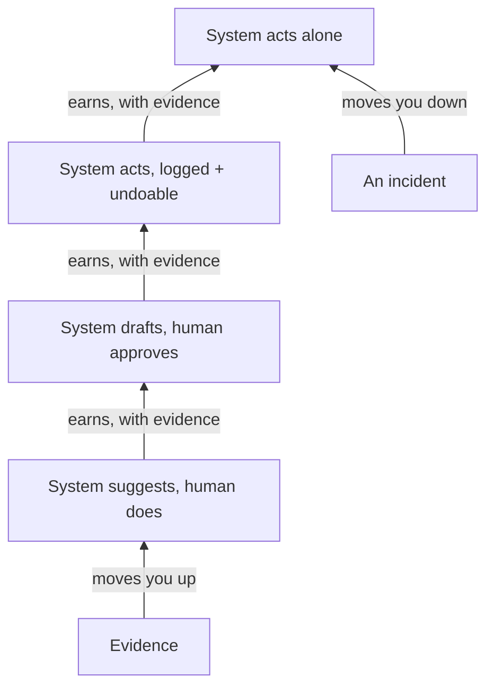

**The idea in one line:** stakeholders who ask for full automation want control, so grant trust in slices, earned by evidence.

At the start, a stakeholder often says "just automate the whole thing." Two weeks later, shown a system that does exactly that, they ask whether a person can check each result first.

Both are sincere. The first was about a system they imagined. The second is about a real one that might make a mistake with their name on it.

They want control over outcomes that matter to them, and they cannot yet know if your system deserves trust. Nobody can until they have seen it behave.

Two terms help:

- An **approval gate** is a point where the system stops and waits for a person to say yes.
- A **scoped permission** covers one specific thing, not everything.

Both grant trust in slices: a little at first, wider as the system proves itself.

Here is the analogy. When you leave a house-sitter for a week, you do not hand over every key and your bank card on day one. You give the front door key and the plant schedule.

If the plants thrive and the mail is tidy, next trip you add the car.

> Trust is earned by behaviour in small, bounded areas, and the person granting it keeps the right to say "not that yet."

## Real-world example: the engine we refused to switch on

We rebuilt the engine that decides when our system sends follow-up emails to real people. By every internal measure it was better than the old one. We still did not switch it on.

The new code shipped **dark**: deployed behind a **feature flag**, a switch that keeps it dormant while the old behaviour carries on.

Then it ran on a **canary**, a deliberately small slice (ten domains), where a person reviewed every email before it went out. Even that took a **dry run**, a full rehearsal that sends nothing, which a person approved first.

We built the engine, believed in it, and still treated our own confidence as insufficient evidence.

The flag, the dry run, the ten domains and the human review are rungs on a ladder. The system earns each one with behaviour, and only after the canary behaves does the flag open wider.

The cost is speed. An afternoon switch-on takes days, and someone reviews sends that were almost certainly fine. We pay that gladly. The ladder is what lets us automate something as touchy as emailing real people at all.

## See it yourself (2 minutes)

Open any AI chat and paste this:

> I want to automate a task for my team, but my manager says "automate
> everything" and then gets nervous. Design a trust ladder for me:
> four stages from "system suggests, human does it" to "system acts on
> its own," with what must be true before moving up each rung and
> what would send us back down.

The best climbing conditions are measurable, like "ninety-five of the last hundred suggestions were accepted unchanged."

## What this means when you build

In Project 4 you design a system that acts on the world. Your mentor skill asks you to plan its permissions as a ladder, not a switch:

- Which actions can the system take on its own?
- Which wait for a person?
- What evidence moves one from the second list to the first?

Write that down before you build, and show it to your stakeholder as part of the pitch.

When someone says "automate everything," a good reply is "yes, in stages, and here is how we decide the next one."

## Check yourself

Your rebuilt follow-up engine beats the old one on every internal measure. Do you switch it on for everyone tomorrow? Answer yes or no, and name your first, smaller step.

Decide on your answer, then open

No. Ship it dark behind a feature flag, get a dry run approved, then run a canary on a small slice (ten domains in our case) where a person reviews every send. Your own confidence in what you built is not evidence, and the system has to earn each wider rung with behaviour.

