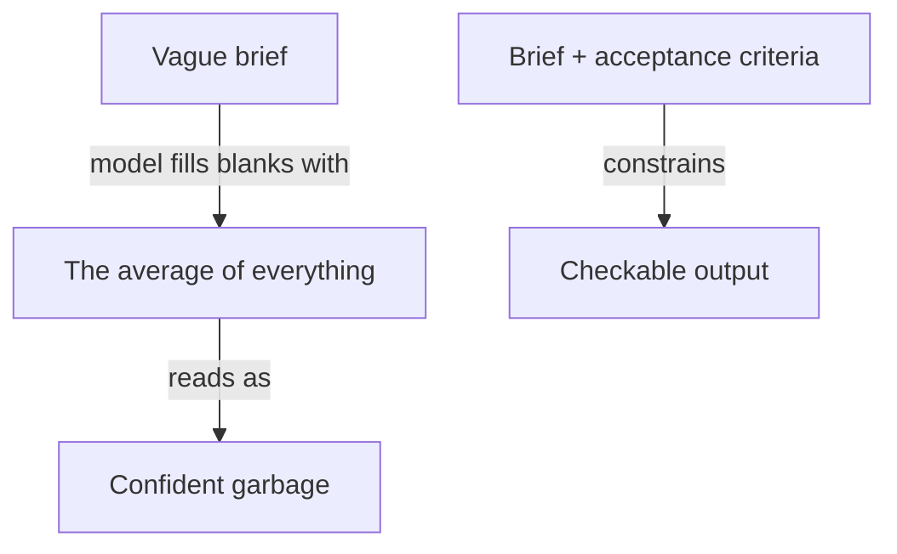

**The idea in one line:** every gap in your request gets filled with the most average guess, delivered confidently.

A vague request gets back an answer that is polished and sure of itself, about something slightly different from what you wanted. Nothing in the output warns you.

A model continues text with whatever is most likely next. "Write a cold email to a recruiter" leaves undecided who the recruiter is, what you offer, how long, what tone. For each blank, the likeliest choice is the most common one: the average of every cold email it has seen, in flawless grammar.

Here's the analogy. Tell a taxi driver "take me somewhere nice" and you get somewhere, confidently. Say "Terminal 2, there by 6:15, I have luggage" and the same driver gets you there. The brief improved, not the driver.

> A prompt is a brief for a contractor you can't phone. Whatever you leave
> blank, the model fills with the average.

The same request, before and after:

- **Before:** "Write a cold email to a recruiter."
- **After:** "Write four sentences to a recruiter at a 30-person logistics firm. Our service is a weekly list of companies hiring in their region. State this week's count as [N]. No adjectives about us. End with a yes/no question."

A useful brief answers four things:

- **Who is this for, and what is it for?** Name the audience.
- **What material should it use?** Paste the facts in. The model can't fetch what it hasn't been given.
- **What are the constraints?** Length, tone, and what to do, not only what to avoid.
- **What does done look like?** The output's shape, plus a test you could apply: "every claim must come from the material above," "exactly one call to action."

These **acceptance criteria** make a prompt checkable. Adjectives ("compelling, authentic, punchy") add vagueness, since each is another blank filled with the model's average idea of the word. Concrete beats descriptive.

> **Common misconception:** "Once a prompt works, it works everywhere." One widely read guide calls prompting an empirical science, with results that vary widely between models. One provider advises giving reasoning-focused models a goal, like a senior colleague, and others explicit steps, like a junior one.

## Real-world example: five perfect emails from one mold

When we first drafted cold emails with a model, they looked excellent: grammatical, structured, polite. Read one at a time, you'd approve any of them.

Then we laid five side by side. Same opening, same generic thesis about hiring, same smooth close. We had asked for emails and got the average email, five times.

The fix was one rule about content. Every email had to contain one concrete, checkable, true offer sentence the recipient could verify. Once the brief demanded a fact instead of a tone, the sameness broke, because facts differ per recipient and boilerplate does not.

## See it yourself (2 minutes)

Send the "before" and the "after" to any AI chat, each in a fresh chat. Count the choices the first one made for you.

## What this means when you build

In Project 1 you write the acceptance criteria in plain sentences before any prompt. Keep standing rules separate from per-request material, with the variable material last. When a result looks fluent and wrong, ask "which blank did it fill with the average?"

## Check yourself

A teammate fixes a vague prompt by adding "make it compelling, authentic, and punchy." Does that add blanks for the model to fill, or remove them? Say why.

Decide on your answer, then open

It adds them. Each adjective is another blank the model fills with its average idea of the word, so you get more of the same polished sameness. What broke it in our cold emails was demanding a concrete, checkable offer sentence.

## Go deeper

- [Prompt Engineering (Lilian Weng)](https://lilianweng.github.io/posts/2023-03-15-prompt-engineering/): a survey of prompting methods that treats it as an empirical science. From 2023, so some findings predate current models.
- [Prompt engineering (OpenAI docs)](https://developers.openai.com/api/docs/guides/prompt-engineering): how one provider structures standing rules, examples and variable context, and how it advises prompting reasoning models differently.
- [Writing effective tools for agents (Anthropic)](https://www.anthropic.com/engineering/writing-tools-for-agents): the same lesson applied to tool descriptions, where small wording changes altered agent behavior.
