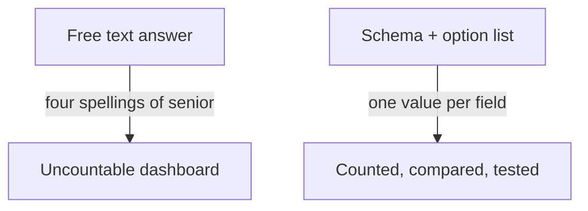

**The idea in one line:** make the model answer in fixed fields from fixed options, so software can count and test it.

A person can cope with "looks senior, probably remote, mostly Europe I think." A database can't. Dashboards and the next program in your pipeline want fields: a seniority column with one value, a remote column with yes or no.

A **structured output** is an answer in a fixed shape you set in advance, most often **JSON**: plain text with labeled values inside curly brackets:

`{"seniority": "senior", "remote": "yes", "regions": ["europe"]}`

The description of which names are allowed, what type each value has and which values are legal is a **schema**.

Here's the analogy. A clinic's front desk could ask "How are you feeling?" and get a warm paragraph, or hand over an intake form with a severity box and symptoms to tick. The form can be filed, counted and passed to the next nurse. A schema is the intake form for a model.

> A schema is a contract: this is exactly what you'll receive, in exactly
> this shape. Check every answer against it before it touches anything real.

Many providers offer a mode that forces output to match a schema; one describes compiling it into a grammar that limits what the model may write. Without one, you ask, then check, and treat a mismatch as a failure to handle.

Most of the thinking goes into the allowed values. If seniority is open text, the model may write "senior," "Senior," "sr." or "mid-to-senior," and your dashboard counts four categories. A fixed list (intern, junior, mid, senior, lead, none of these) is countable.

A good list covers every case, including an honest "cannot tell"; its options don't overlap, so two readers pick the same one; and each is named for what a reader can see. Shape fields so an invalid state can't be expressed: one provider's guide warns that separate "on" and "off" switches allow both true or both false, where one closed-list field cannot.

> **Common misconception:** "If the output matches the schema, it's correct." A schema fixes the shape, not the truth: a well-formed "seniority: lead" can still be wrong, and provider docs note a refusal or cut-off answer may not match at all. Check meaning in your own code.

## Real-world example: the option list that does the work

The cheaper models in our pipeline answer only from fixed option lists we design, never in free-form text. A posting comes in with a list of choices, and the model's whole job is to pick.

The list is the engineering: which options exist, where each ends, what happens to the posting that matches none. A weak list can't be rescued by a clever prompt, and a clean one makes even a small, inexpensive model reliable.

## See it yourself (2 minutes)

In any AI chat, send:

> Read this and answer ONLY with JSON having two fields: "urgency" (one of
> "low", "medium", "high") and "topic" (one of "billing", "bug", "other").
> Message: "Hi, I was charged twice last month and I'd like this sorted
> before Friday if possible."

Check the shape. Now try "Do you have an office dog?", a case your list didn't anticipate. Then add an "unclear" option and send both again.

## What this means when you build

In Project 1 you write a schema before a prompt. Each field gets a name, a type and, where possible, a closed list with a sentence per option. Check shape and correctness separately. Expect more time on lists than instructions.

## Check yourself

An open-text seniority field comes back as "senior", "Senior", "sr." and "mid-to-senior". How many categories does your dashboard show, and what is the smallest fix?

Decide on your answer, then open

Four, because software counts each spelling separately. The fix is a closed list plus an honest "none of these" option.

## Go deeper

- [Function calling guide (OpenAI)](https://developers.openai.com/api/docs/guides/function-calling): how one provider defines tools with strict schemas, including the advice to use closed lists so invalid states can't be expressed.
- [Instructor documentation](https://python.useinstructor.com/): a library that describes the shape as a typed model, adds checks the schema can't express, and re-asks the model on failure. Written by the library's maker.
- [Instructor: retrying](https://python.useinstructor.com/concepts/retrying/): how bounded retries work and why nested retry layers multiply requests.
