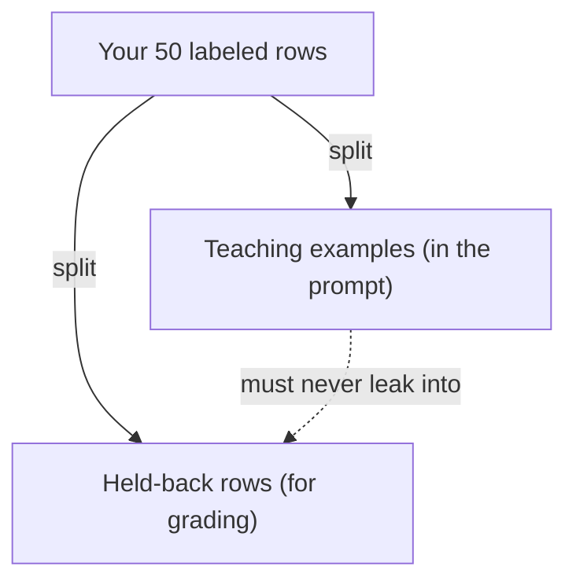

**The idea in one line:** a few well-chosen examples can teach a judgement that a page of rules can't.

Explain "good lead" versus "bad lead" in words and you end up with rules, exceptions and a paragraph nobody applies consistently. Pointing at six real leads (two good, two bad, two borderline and why) is shorter and usually works better.

Putting examples inside a prompt is called **few-shot prompting**: a "shot" is one worked example. It works because a model continues patterns. If the text shows three inputs each followed by its correct label, the likeliest continuation of the fourth is its correct label. Nothing gets retrained.

Here's the analogy. A coach can talk for an hour about "reading the game," or pause a recording: here he shot, and it was right, because the keeper was out of position. Here it was wrong, because two teammates were open. After twenty clips the player has a judgement nobody could write as a rulebook. Examples are film clips for the model.

> The rows that make you hesitate are the ones worth showing the model.

Which examples you pick matters more than how many:

- **Show the edges.** Easy cases teach nothing. Spend examples on borderline ones, with the reasoning if your format has room.
- **Cover every option.** If your list has five labels and your examples show three, the other two will be under-used.
- **Stay consistent.** If two examples contradict, the model averages them.
- **Mind the order and the mix.** One survey describes three pulls: toward the label that appears most, toward the last one shown, and toward common words. Balance and shuffle.

> **Common misconception:** "More examples, or a bigger model, will settle it." The survey cites work finding that example order alone can swing results from near-random to near-best, and that neither larger models nor more examples removed the effect. One provider warns examples may even hurt reasoning-focused models.

## Real-world example: the fifty rows that paid twice

For our classification work we hand-labeled sets of about fifty rows: a person read each posting and wrote the correct answer. It took patience, not cleverness.

Those rows did double duty, as teaching examples and as the answer key. The catch: a model graded on rows it was shown has been handed the answers, and a high score measures its memory. So the set has to be divided: some rows go in the prompt as teaching, the rest stay hidden for grading. Fifty rows is a workable split, but not one to spend carelessly.

## See it yourself (2 minutes)

In any AI chat, first ask with no examples:

> Label this message as "complaint", "praise", or "question": "Well, the
> delivery was only three days late, so I suppose I can't complain."

Now start a new chat and teach by example:

> Label each message as "complaint", "praise", or "question".
> "Where's my order?" -> question
> "Fast and well packed, thank you." -> praise
> "Great, another late parcel. Brilliant." -> complaint
> "Arrived on time, though the box was dented." -> praise
>
> Now label: "Well, the delivery was only three days late, so I suppose I
> can't complain."

See whether the label changed. Then swap in a contradictory example and resend.

## What this means when you build

In Week 3 you hand-label a small set, then split it into a teaching portion and a held-back portion the model never sees until grading. Pick teaching examples from the cases you'd argue about with a colleague.

## Check yourself

You hand-labeled 50 rows, put all 50 in the prompt as examples, and the model scores 98% on those same 50. Do you trust the 98%, yes or no?

Decide on your answer, then open

No. The model was shown those answers, so the score mostly measures memory. Split the set: some rows teach, the rest stay hidden for grading.

## Go deeper

- [Prompt Engineering (Lilian Weng)](https://lilianweng.github.io/posts/2023-03-15-prompt-engineering/): the few-shot section covers example choice, order and the three biases. From 2023, so findings come from older models.
- [Prompt engineering guide (OpenAI)](https://developers.openai.com/api/docs/guides/prompt-engineering): how one provider places a handful of diverse examples inside the standing instructions.
- [Function calling guide (OpenAI)](https://developers.openai.com/api/docs/guides/function-calling): where the caution about examples and reasoning-focused models appears, alongside how to describe tools so a newcomer could use them.
