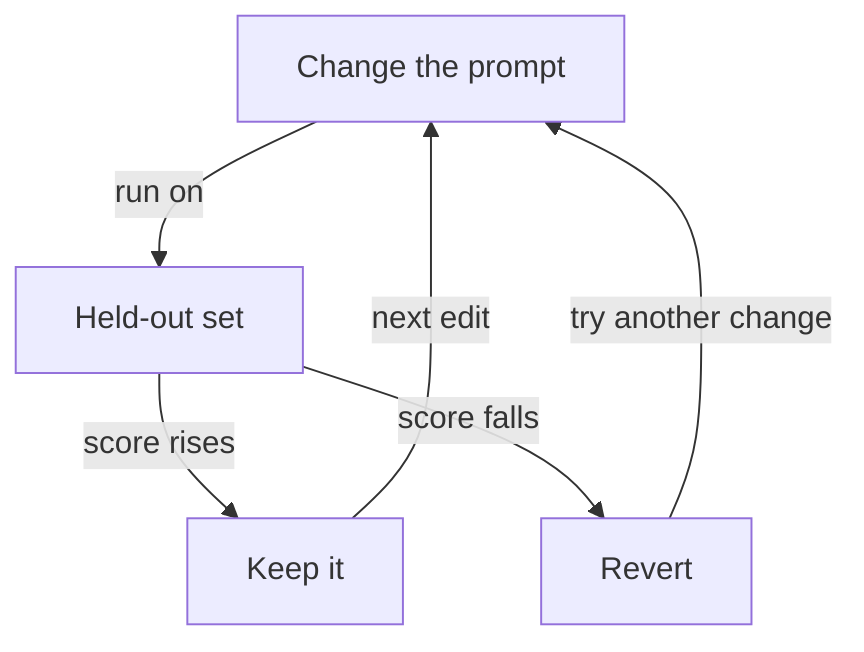

**The idea in one line:** a prompt change is better only if a score on hidden, hand-checked rows says so.

You rewrite a prompt, try it on two or three examples, and the outputs look sharper. Next week someone rewrites it again and feels the same. Either change may have made things worse where nobody looked.

Models vary run to run, so one try can look better by luck. A change that fixes the three cases you stared at can quietly break thirty you didn't. A prompt change is a medicine with side effects, and feeling better is a poor detector.

Measuring needs three ingredients:

- **Labeled rows:** inputs with answers a person wrote before you started tuning.
- **A held-out set:** rows you never use while adjusting the prompt, so they can't leak into your decisions.
- **A fixed number:** a score computed the same way every time, such as the share of answers matching the person's.

Here's the analogy. You buy new running shoes and swear you feel faster. Maybe it's the sunshine. A runner who wants to know times one route in old shoes, then new. The held-out set is the course, the accuracy number the stopwatch.

> The word "better" earns a place in your write-up only when a number you
> can rerun sits behind it.

Three disciplines keep the score honest:

- Keep peeking at the held-out set and adjusting, and you teach to the test. Fetch fresh rows.
- When two prompts score close together, run each more than once. A gap smaller than the run-to-run wobble tells you nothing.
- If a model grades the outputs, check that grader against your own labels, on passes and fails separately. A grader that always says "pass" agrees with you 95% of the time if only 5% of cases fail.

Keep cost and speed beside accuracy, so a point gained at triple the price is a knowing trade.

> **Common misconception:** "If it looks better on a few tries, it is." One practitioner account describes a team whose prompt work moved fast, then stalled in whack-a-mole: each fix broke something else while the prompt bloated. Their way out was layered tests: cheap automatic checks on every change, human review of real outputs, live A/B tests last.

## Real-world example: three models, one exam

We had to choose a model to classify job postings. We ran a budget, a mid-tier and a frontier model on the same hand-labeled held-out rows.

The measurement decided it. The budget model handled most rows correctly at a small fraction of the cost; the capable models earned their price only on harder rows. So the budget model takes the first pass, and escalation rules send difficult cases up for a second look.

Without the held-out set, someone would have picked the biggest model.

## See it yourself (2 minutes)

Write eight short customer messages and label each by hand as "refund", "bug" or "question" before touching an AI. Ask any AI chat to label them with a bare prompt and count the matches. In a new chat, use a longer prompt and count again. The higher score is better on your eight, a smaller claim than it feels like. Rerun the winner and see if the count holds.

## What this means when you build

In Project 2 you hold back a labeled set before tuning and don't look at it until scoring. Each prompt change is logged with accuracy, cost and speed, so you answer "why does it read this way?" with rows, not recollections.

## Check yourself

Prompt A scores 84% on your held-out set and prompt B scores 85%. Each prompt's score wobbles by about 3 points between runs. Do you declare B the winner?

Decide on your answer, then open

No. A one-point gap is smaller than the run-to-run wobble, so it tells you nothing yet. Run each more than once, and weigh cost and speed before choosing.

## Go deeper

- [Your AI Product Needs Evals (Hamel Husain)](https://hamel.dev/blog/posts/evals/): the three-level test habit and the team story behind it. A practitioner's account from 2024, and the tool names in it are dated.
- [Using LLM-as-a-Judge For Evaluation: A Complete Guide (Hamel Husain)](https://hamel.dev/blog/posts/llm-judge/): how to calibrate a model grader against one domain expert's pass/fail calls with written reasons.
- [promptfoo: getting started](https://www.promptfoo.dev/docs/getting-started/): a runnable regression test for prompts. Its cost and latency checks inspect finished responses and do not cap spend.
