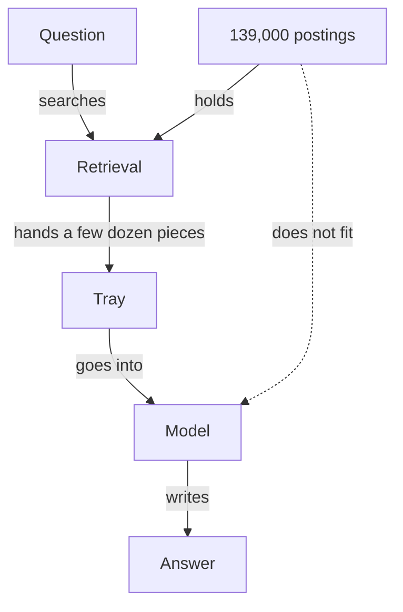

**The idea in one line:** pasting everything fails on size, cost and quality, so search first and send only what matters.

Almost every beginner starts here: the model can read, so hand over the whole pile and ask. For a handful of short documents, that works, and you should do it. As the pile grows, it fails three ways:

- **Size.** A model can only consider so much text at once. That limit is its **context window**, measured in tokens, the small chunks of text from the earlier notes. Text outside it is never seen.
- **Cost.** You pay for every token on every question. A hundred questions over a thousand pages means paying for a hundred thousand pages.
- **Quality.** Even when everything fits, answers often get worse. The model must find two relevant sentences among thousands and may latch onto something nearby that only sounds right. One vendor study held the task fixed and only lengthened the input, across 18 models. Reliability fell as input grew, even on trivial tasks.

Here's the analogy. A surgeon doesn't operate with the hospital's supply room dumped onto the table. Someone prepares a tray: the dozen instruments this operation needs, within reach.

That tray-preparing step is **retrieval**: searching a large collection for the few pieces relevant to this question. The whole pattern, retrieve first and then answer from what was retrieved, is **RAG**, short for retrieval-augmented generation.

> More text is not more help. The skill is choosing what goes on the tray.

> **Common misconception:** "My model accepts a huge context window, so I can just include everything." A window limits what fits, not what gets used well. The same study found that even one similar-looking but irrelevant passage hurts, and several hurt more.

## Real-world example: the board no window could hold

Our job board holds more than 139,000 postings. A visitor asks, "Which remote data roles are open to someone in India at the senior level?"

Even short postings add up to tens of millions of words, orders of magnitude beyond any context window.

So we never tried. Search runs first and picks the few dozen rows that could answer. Only those go to the model.

The arithmetic left no alternative, and it moved the quality into search: if the right posting never reaches the tray, the model can't use it and will answer confidently from whatever did arrive.

## See it yourself (2 minutes)

In any AI chat, paste one paragraph of anything handy and ask a question about a small detail in it. Then paste nine unrelated paragraphs after it and ask again, adding: "Tell me honestly whether the extra text made your job harder." Often the answers match; the model's own account is the interesting part.

## What this means when you build

In Project 3 you build a knowledge agent over a collection too large to paste. Your first decision is the tray: how documents get split into pieces, how the right ones get found, and how many go to the model. Predict how many pieces a typical question needs and what it will cost, then check against the harness.

Search is where the gains are. One vendor study measured retrieval failures falling from 5.7% to 1.9% as three techniques stacked: a short note on where each piece came from, exact-word matching beside meaning-based search, and re-ranking the results.

## Check yourself

On a 139,000-posting board, an answer comes back confidently wrong. Do you look first at the model or the search step, and why?

Decide on your answer, then open

Look at the search step first. Only what it puts on the tray reaches the model, so if the right posting never arrives, the model answers confidently from whatever did. Most of a RAG system's quality lives in retrieval.

## Go deeper

- [Context Rot: How Increasing Input Tokens Impacts LLM Performance](https://www.trychroma.com/research/context-rot): the long-input study behind the quality claims above. Written by a search-infrastructure vendor, and its authors say real tasks are likely harder.
- [Introducing Contextual Retrieval](https://www.anthropic.com/engineering/contextual-retrieval): the source of the stacking numbers, with the full mechanism. These are the publisher's own results on its chosen setup.
- [Systematically Improving Your RAG](https://jxnl.co/writing/2024/05/22/systematically-improving-your-rag/): how to measure retrieval on its own before blaming the model.
