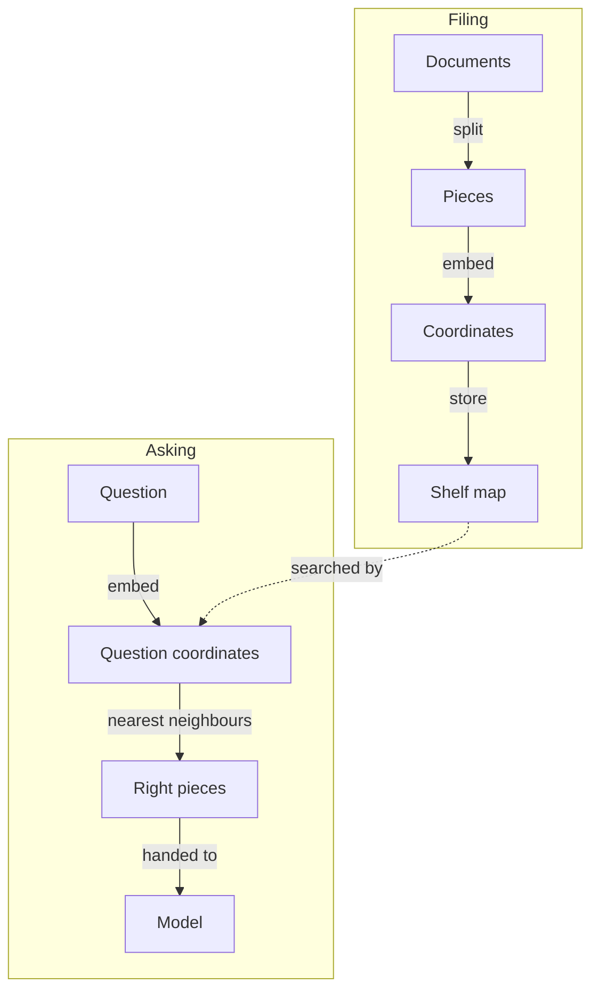

**The idea in one line:** an embedding turns meaning into coordinates, so search finds what's close in meaning, not just in words.

Retrieval finds the few pieces of a collection relevant to a question, so you hand only those to a model. The last note said why. This one says how, and the trick is a word you'll hear constantly: **embedding**.

Classic search matches words. Type "cheap flights" and it looks for documents containing "cheap" and "flights." A document saying "affordable airfare" shares no words with your query, so it never shows up.

Here's the analogy. Two librarians. The first files books alphabetically by title, so you must roughly know what a book is called. The second places each book on a map by meaning: cooking near gardening, both far from tax law.

Ask for "something about making bread at home" and she walks you to the right shelf, even if no title says "bread."

An embedding is the second librarian's shelf position, written as a list of numbers. A special model reads a piece of text and outputs hundreds or thousands of numbers, always the same count whatever the text's length, that act as coordinates on a map of meaning. "Affordable airfare" lands near "cheap flights," "quarterly tax filing" far away.

> Once everything has coordinates, search becomes geometry: embed the
> question, then fetch the pieces that sit closest.

Two phases:

- **Filing, before anyone asks:** cut documents into pieces, embed each, store them.
- **Asking, per question:** embed the question with the same model, find the nearest pieces, pass them to the answering model.

One honest caveat: **close is not the same as answering.** A passage about "how to cancel a subscription" sits near "can I get a refund?" and may not contain the refund policy. Retrieval finds the right neighbourhood, not always the right house. The general map can also be weaker on your internal jargon.

> **Common misconception:** "Meaning search always beats word search." One vendor write-up notes meaning search can miss an exact code such as "Error code TS-999" that word matching catches. A practitioner who compared both found them roughly tied on essays, with word search faster, and meaning search ahead on messy issue-tracker text. Combine both, then test on your data.

## See it yourself (2 minutes)

In any AI chat, paste this:

> Rank these five sentences by closeness in meaning to "How do I get my money back?", ignoring word overlap. Then say which shares the most words with the question but ranks lower.
>
> 1. Refund requests are processed within ten days.
> 2. Our returns desk reimburses customers for faulty items.
> 3. How do I get to the money market on Friday?
> 4. The back office handles payment disputes.
> 5. Your money is safe with us.

Sentence 3 matches the words but not the meaning; 1 and 2 match the meaning with different words. A word-matching search would rank sentence 3 uncomfortably high. That gap is what embeddings close.

## What this means when you build

In Week 6 you make the filing decisions: how big each piece is and how many to retrieve per question. Too small and an answer splits across shelves; too large and the useful sentence drowns. Test retrieval by hand before connecting any model: ask ten questions and check the right passage is in the top few. Embeddings from different models can't be compared, and providers retire models, so plan to re-file everything if you switch.

## Check yourself

You test your retrieval by hand with ten questions before connecting any model, and for three of them the right passage isn't in the top few results. Can a better model fix that, and what could you change instead?

Decide on your answer, then open

No. The model only sees what retrieval hands it, so a missing passage can't be recovered downstream. Change the filing decisions instead: piece size and how many pieces you retrieve per question.

## Go deeper

- [Embeddings: What they are and why they matter (Simon Willison)](https://simonwillison.net/2023/Oct/23/embeddings/): a hands-on tour, from related-article search to a question-answering demo on a laptop. Written in 2023, so the model names are dated and the ideas are not.
- [Introducing Contextual Retrieval (Anthropic)](https://www.anthropic.com/engineering/contextual-retrieval): combining meaning search with exact-word matching. These are the publisher's own results on its chosen setup.
- [Systematically Improving Your RAG (Jason Liu)](https://jxnl.co/writing/2024/05/22/systematically-improving-your-rag/): where word search tied or beat meaning search, and how to find out for your own data.
