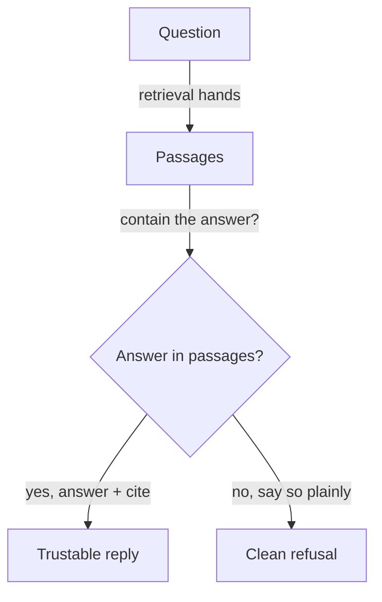

**The idea in one line:** a knowledge agent must say "the documents don't cover that" instead of guessing smoothly.

A model produces fluent answers, because continuing the conversation is what it does. That's its most dangerous habit: it has no natural way of saying "I don't know." A gap in knowledge becomes a plausible paragraph that sounds identical whether true or invented.

A false statement made with full confidence is called a **hallucination**, though "confident guess" is closer. If a knowledge agent fills gaps with fiction, the reader can't tell which sentences were real.

The defence has three parts:

- **Grounding:** the model answers only from the passages retrieval handed it, not general memory.
- **Citations:** every claim points to its passage, so a human can check in ten seconds. A claim with no citation shouldn't be trusted.
- **Refusal:** when the passages lack the answer, the agent says so plainly and stops. "The documents don't cover that" is a correct answer, and shows where your knowledge ends.

Here's the analogy. A pharmacist handed a smudged prescription can guess at the dose or ring the doctor. Guessing is faster and usually right, which is why it's dangerous: when it's wrong, nothing in their tone warned anyone. Pharmacies treat ringing the doctor as professional. A knowledge agent needs that norm built in, because its default is to guess.

> A confident wrong source and a confident right source look the same from
> the outside.

> **Common misconception:** "A good system always answers." One vendor study fed models questions whose answers were absent and found a split: some models often said no answer could be found, while others more often answered confidently and wrongly. It warns abstentions can pass for low accuracy, so count refusals and wrong answers separately.

## Real-world example: the API that was confidently wrong

We needed to know whether certain domain names were available to register. A free availability service told us, with no hedging, that they were.

They were taken.

We caught it by re-verifying against the authoritative registries, the official databases of who owns what, and adding two control names: one certainly taken, one certainly free. A trustworthy source says "taken" for the first and "free" for the second.

The free service got the controls wrong. Its wrong answers came in the same clean, definite format as its right ones, so only the control names exposed it.

The lesson: include cases where you already know the answer, and build a system willing to say "I couldn't verify this."

## See it yourself (2 minutes)

In any AI chat, ask about something a source lacks:

> My entire knowledge base: "Our shop opens at 9am and closes at 5pm Monday to Friday. We sell bicycles and repair kits." Answer only from this text and cite the sentence you used. 1: What time do you close on Tuesday? 2: Do you offer free delivery? 3: Do you sell helmets?

Questions 2 and 3 have no answer in the text. Notice whether it refuses cleanly, hedges, or invents. Then rerun with "If the text doesn't answer, say exactly: not in the documents."

## What this means when you build

In Week 6 you write the questions your documents can't answer into your own eval, and run `/agent-school:check`, to see whether you built a refusal path or a guess machine. Write it on purpose: what counts as "not in the passages," what the agent says, and what it suggests next.

## Check yourself

To test a free domain-availability service you add two control names: one you know is taken, one you know is free. The service says "available" for both. Which control exposes it, and why does that matter?

Decide on your answer, then open

The known-taken name, because a trustworthy source must say "taken" for it. Its wrong answers arrived in the same clean format as its right ones, so only a case where you already know the answer reveals a confident wrong source.

## Go deeper

- [Context Rot: How Increasing Input Tokens Impacts LLM Performance](https://www.trychroma.com/research/context-rot): includes the abstain-versus-hallucinate comparison. Written by a search-infrastructure vendor, and its authors say real tasks are likely harder.
- [Systematically Improving Your RAG](https://jxnl.co/writing/2024/05/22/systematically-improving-your-rag/): why retrieval is often the real problem.
