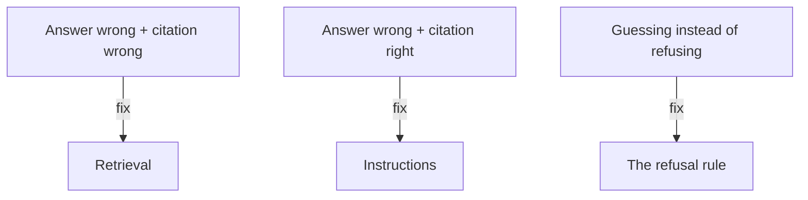

**The idea in one line:** grade answer, citation and refusal separately, because each failure points at a different fix.

You build a system that answers from your documents, try five questions, and the answers look good. That feeling is the problem: five hand-picked questions will flatter any system. You need a test built to catch it out, with "good" defined before you look.

The tool is a **golden set**: questions written down before you build, each with the correct answer and the exact supporting passage. It's an exam written by someone who hasn't seen the student's notes.

A question-answering system can be wrong in distinct ways, and one blended score hides which. Grade three things separately:

- **Answer accuracy:** is the answer itself correct against the golden answer?
- **Citation accuracy:** does the cited passage say what's claimed? A correct answer on the wrong passage is a lucky guess.
- **Refusal correctness:** did it decline questions the documents can't answer, and answer the ones they can? Both directions count, since a system that refuses everything is useless.

Here's the analogy. A driving examiner scores observation, control and parking separately. A bare "62%" wouldn't say whether to practise reversing or checking mirrors.

> Three scores tell you where to spend the next hour of work.

The separation pays off when something breaks:

- **Citations also wrong:** retrieval is handing over the wrong passages, so look at your pieces and search.
- **Citations right, answers wrong:** the model misread what it was given, so look at your instructions.
- **Both fine, refusals weak:** the model guesses when it should decline, so tighten the refusal rule.

You can also score retrieval alone, before any model is involved. Have a model write questions each piece answers, then check search brings that piece back. Since RAG needs several pieces to cover a question, not just a good top hit, one practitioner warns that classic search benchmark scores often fail to predict real RAG performance.

> **Common misconception:** "Bad answers mean I need a better model." One practitioner's account argues retrieval is usually the real problem and should be measured first. Their method: group real user questions by topic and see which groups fail, which for one documentation product exposed outdated pages and gaps around error codes.

## Real-world example: an exam written before the student

There's no incident behind this one. It describes the harness that grades Project 3.

The golden questions are written before any learner build exists, so nobody, including us, can shape the test to fit an answer. Every question has a correct answer and a supporting passage. Some deliberately have no answer in the documents, because refusing correctly is part of the job.

The harness reports three grades as three numbers, never merged. A bold guesser collects points on answerable questions and hides its cost on unanswerable ones. Separate lines make the guess visible.

## See it yourself (2 minutes)

In any AI chat, paste a short paragraph from anything handy, then ask:

> Based only on this paragraph, write five test questions: three it answers and two it does not. For the three, give the correct answer and quote the supporting sentence. Mark the unanswerable two.

In a fresh chat, paste the paragraph and ask the five questions. Grade answer, supporting quote, and refusal of the two it should refuse.

## What this means when you build

In Project 3 your first task is writing your own golden set before touching the build, while deciding what correct looks like is still cheap. Predict your three scores, then compare.

## Check yourself

Your golden-set grades show wrong answers, but the cited passages are correct. Do you fix retrieval or the model's instructions first?

Decide on your answer, then open

The instructions. Right passages with wrong answers means retrieval worked and the model misread what it was handed. If citations were also wrong, you would look at the pieces and the search instead.

## Go deeper

- [Systematically Improving Your RAG (Jason Liu)](https://jxnl.co/writing/2024/05/22/systematically-improving-your-rag/): synthetic questions, a retrieval-first baseline, and clustering real questions to find weak areas. A 2024 practitioner's account, not a controlled study.
- [Introducing Contextual Retrieval (Anthropic)](https://www.anthropic.com/engineering/contextual-retrieval): scores retrieval alone as a failure rate, with the stacking results quoted in the first note of this cluster. The publisher's own results on its chosen setup.
- [Stop Saying RAG Is Dead (Hamel Husain)](https://hamel.dev/notes/llm/rag/not_dead.html): why classic search metrics mislead for RAG. An overview of a longer series, so its quantitative claims are unchecked here.
