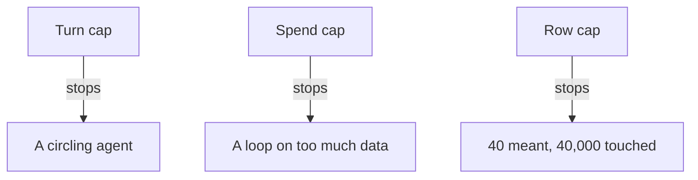

**The idea in one line:** a loop has no natural ceiling, so set caps before the first run.

The last note described an agent as a goal, tools and a loop. The loop is where the money goes. One question to a model costs a small, predictable amount. A loop asks again and again, each time with a longer conversation behind it, because every earlier step is sent back in. Cost grows faster than the turn count.

A loop also needs nobody to tell it to continue. If the agent decides it isn't finished, it goes around again. If it's confused or stuck retrying something that will never work, it can keep going until something external stops it. The only natural ending is success, and you can't assume success.

A **budget** is a ceiling set before the first run: a maximum number of turns, amount of spending, rows touched, or time. At the ceiling the agent stops and reports where it got to. The exact number matters less than having picked one, so the worst case is a figure on a page, not a discovery.

Here's the analogy. A road trip with a fixed jerry can of fuel in the boot: you know how far you can get before you must stop and think. Now the same trip with a fuel pump you can't turn off. The agent loop is the car. The budget is the can.

> A budget turns the worst case from a discovery into a number you chose.

Budgets work best in layers, since each cap stops a different mistake:

- **Turns:** catches a confused agent circling.
- **Spend:** catches a loop that runs fine but on far more data than expected.
- **Rows or items:** catches a batch job meant for forty things and pointed at forty thousand.

## Real-world example: forty rows before eight thousand

After a few early incidents we made a house rule. Every batch pipeline gets a small-limit flag, a switch saying "process only this many rows," and no run touches thousands of rows until a forty-row run has been done and its output looked at by a person. Forty, then eight thousand, never the reverse.

Forty rows is almost free and fast enough that you look before your attention drifts. If the format is wrong or a rule matches the wrong things, you find out at forty rows' cost instead of eight thousand. The bug exists at both scales. Only the bill differs.

One early incident belongs here as a warning. Our enrichment pipeline had a dry-run flag, meant to preview a run without doing it. It actually called the model. For about ten minutes a "preview" burned real money before anyone noticed. A safety switch that doesn't make the safe thing happen is worse than none, because it invites you to relax.

We rebuilt it so a dry run makes zero model calls and prints what each row would cost, and a live run announces itself on its first log line with the row count. The deeper fix was the forty-row habit: dry runs can be wrong, while a small real run costs little and tells the truth.

## See it yourself (2 minutes)

In any AI chat, ask:

> I'm building an AI agent that loops: each turn it reads the full conversation so far, calls a tool, and appends the result. Suppose each turn adds about 500 tokens of new text. Calculate the total tokens sent to the model across 5 turns, 10 turns, and 20 turns, counting that every turn resends everything before it. Show the arithmetic as a table, then tell me what the growth pattern means for setting a turn limit.

Watch how the total behaves as turns double. Then ask for three caps for the same agent (turns, spend, items processed) and which mistake each prevents.

## What this means when you build

Project 1 asks you to put a number on every agent run before it starts: maximum turns, cost and rows. Pick each deliberately, run on forty rows first, and compare against your prediction. A run that stops at its budget and tells you why is a success. One that quietly exceeds it is the one to worry about.

## Check yourself

Your batch job was meant for 40 rows and gets pointed at 40,000. It takes few turns per row and spends a normal amount on each. Which cap catches it: turns, spend per row, or rows touched?

Decide on your answer, then open

Rows touched. Nothing is looping and nothing is expensive per item, so the turn cap and per-row spend stay quiet while the total quietly balloons. Each cap stops a different mistake, and the forty-row first run is the cheapest version of the row cap.

