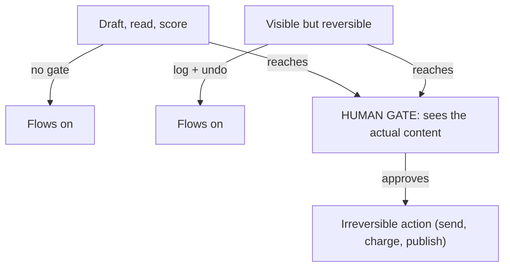

**The idea in one line:** put a human approval immediately before the first step that can't be undone.

An **approval gate** is a point where an automated process stops and waits for a person to say yes, even if the system is confident. A human looks at what it's about to do and lets it through or sends it back.

Beginners treat gates as safety versus speed, which leads to two bad designs. Gate everything, and the human drowns in trivial approvals, clicks "yes" without reading, and the gate becomes decoration. Gate nothing, and the first serious mistake goes straight out the door.

The better question for any action: if the agent gets it wrong, can we undo it? That's **reversibility**, and it sorts actions into three groups:

- **Reversible and private:** reading a document, drafting an email into a folder, scoring a lead. Delete the draft and nothing happened. No gate.
- **Reversible but visible:** updating a field others read, moving a row between lists. Mistakes can be repaired, but someone may see them first. A log and an undo are often enough.
- **Irreversible or outward-facing:** sending a message to a real person, charging a card, publishing a page, deleting without a backup. The consequences land on someone who didn't agree to your experiment. These deserve a real gate: a human looking at the specific thing, not a blessing given in advance.

Here's the analogy. A newspaper's writers draft freely and nobody reviews each sentence as it's typed. But before the press runs, someone signs off on this edition, because ink on a hundred thousand copies can't be unprinted. The gate sits at the press, not at the keyboard.

> The gate belongs immediately before the first step that can't be taken
> back, and it shows the human the actual action, not a summary of intentions.

A gate at the start ("approve this whole project") is too early, since the human can't know what the agent will propose. A gate at the end of a long chain is too late if earlier steps already did irreversible things.

## Real-world example: the gate in front of send

Our outreach system emails real people, and models help with much of the work leading up to that.

But nothing emails a real person without a human approving that specific send. Not the batch, not the campaign, not the template: the individual message to the individual recipient. The approver sees the actual text going to the actual person, and only then does it leave.

There's no disaster to report, which is what a good gate is for. Everything before the gate can be fast and cheap, because nothing there is permanent. Drafts can be regenerated and bad candidates dropped. The agent can be wrong in private as often as it likes. Only the final step is slow and careful, which is the one place slow is the right speed.

## See it yourself (2 minutes)

In any AI chat, ask:

> Here are ten actions an AI agent in a small company might take: read a customer's order history, draft a reply, send the reply, add a tag to a CRM record, issue a refund, post to the company social account, summarise a meeting, delete an old spreadsheet, book a meeting on someone's calendar, rank leads by score. Sort them into: no gate needed, log and allow undo, human must approve each one. Explain any you found hard to place.

Disagree with at least one sorting choice and argue the other side. The hard cases are the useful ones.

## What this means when you build

In Week 7 you build an agent that touches the outside world, and your design review starts with its actions sorted by reversibility. Gates go in front of the irreversible ones, showing the real content to a real person. Everything else you make cheap and free to be wrong in.

## Check yourself

In our outreach system, models draft emails and score candidates freely. Which single step gets a human approval, and what exactly does the approver have to see?

Decide on your answer, then open

Only the final send, one message to one recipient, gets approved. The approver sees the actual text going to the actual person before it leaves. Everything earlier can be fast and wrong in private because drafts can be regenerated and candidates dropped.

