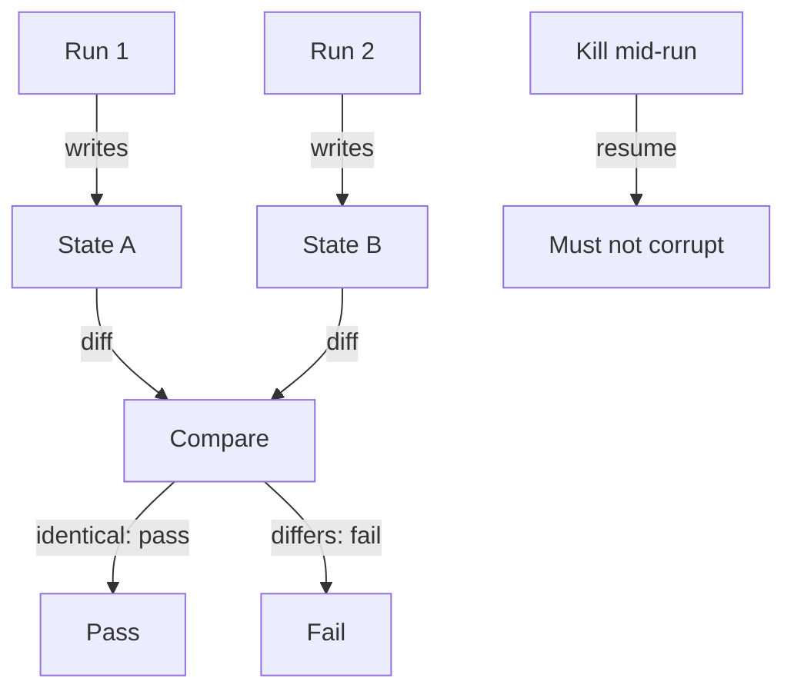

**The idea in one line:** design every pipeline so running it twice leaves the data exactly as running it once.

Sooner or later someone runs your pipeline again. A scheduler fires twice. A person presses the button, sees nothing for a moment, and presses it again. The job crashes halfway and restarts. None of that is misuse. It's what real operations look like.

The property you want is **idempotent**, an awkward word for a plain idea: doing an operation twice leaves the world in the same state as doing it once. The first run does the work. A second run finds it done and changes nothing.

Here's the analogy. Press the lift call button again and again, impatiently. You don't get three lifts, because the button records "someone wants to go up." Now a vending machine where each press drops a new bag of crisps: press twice, get two bags and a bill for both. One button was designed so repetition is harmless.

Pipelines tend to be vending machines because the natural way to write "store this result" is to add a row. Run it twice and you've added two. Any single run behaves correctly, so the bug hides during development, when you ran it once and it looked fine.

> The bug lives in the interaction between runs, so no one can spot it by
> reading the code of a single run.

The usual cure is to give every piece of work an identity, a **key**, that stays the same across runs: this document, this posting, this customer. "Store this result" becomes "store the result for this key, replacing any earlier one." A second run overwrites identical data or skips it. Same input, same final state.

Crashes ask a harder version. Kill a pipeline halfway and restart it. A well-built one picks up where it stopped, or redoes the unfinished piece, without corrupting completed work. A badly built one either starts over and duplicates the first half, or skips ahead and leaves a hole. The test for both is cheap.

## Real-world example: the second run that was not harmless

You met this incident briefly in the note on why answers differ between runs. Here it is from the operations side. In some early builds, running a pipeline a second time created duplicate rows. The first run was fine. The second just added another copy of what the first had stored.

It cost us duplicated rows to find and clean up, and it became our harness doctrine. Run the pipeline, run it again, and compare the database before and after the second run. If anything differs, the check fails. Then kill a run partway, restart it, and check that resuming corrupts nothing.

The test is unglamorous, which is why it's reliable. You take a picture of the database, rerun, take another picture, and look for a difference. A reviewer reading one run's code has little chance of spotting this bug.

## See it yourself (2 minutes)

In any AI chat, ask:

> I have a script that, for each customer in a list, inserts a row into an "invoices" table. It runs nightly. Walk me through exactly what happens if it runs twice by accident on the same night. Then show me, in plain words, two different ways to change the design so the second run does nothing. Finally, describe a test I can run by hand to prove it works.

Notice which fixes depend on a stable key per piece of work. Then ask what should happen if the script crashes after half the customers and is restarted.

## What this means when you build

When you build, run your pipeline twice on purpose, with the database compared in between, and once more killed mid-run and resumed. Predict the result first. Build for repetition from the first line, with a key for every unit of work, and the check is a formality.

## Check yourself

Your pipeline's first run looks perfect. What do you do next to find the duplicate-rows bug we hit, and what result means the pipeline fails?

Decide on your answer, then open

Run it a second time and compare a snapshot of the database before and after that second run. If anything differs, such as a duplicated row, it fails. Also kill a run partway, restart it, and check that resuming corrupts nothing, since the bug lives in the interaction between runs and not in any one run's code.

