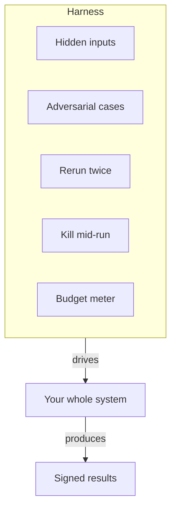

**The idea in one line:** a harness is all your distrust collected into one program that attacks your system on demand.

You've met tests: small checks that a function returns the right value. A **harness** stands outside your whole system and drives it the way reality would:

- feeding it inputs you didn't hand-pick, including some designed to fool it
- running it twice and comparing the aftermath
- killing it mid-run and watching the restart
- metering what it spends

A unit test asks "does this piece work?" A harness asks "does the whole thing survive contact with the world?"

The earlier notes in this cluster each gave you one harness check without naming the machine. The budget is one. The run-twice comparison is one. The refusal questions in the knowledge-agent notes are too. A harness collects them so that being suspicious stops depending on anyone remembering to be.

Here's the analogy. A car manufacturer keeps a crash-test facility whose whole purpose is destroying the company's own product. Cars are driven into walls, dropped, rolled and frozen while instruments record what breaks. Nobody there trusts the brochure. The company pays for this institutionalised doubt because the alternative is letting the public run the crash test. Every input your harness hurls is a wall you chose instead of one a user found.

> Each incident becomes a check, and the checks accumulate. The system gets
> harder to break because it has been broken before.

A harness can hold business rules too, not just quality checks. A test encoding "this must always be true of our output" is a **guard test**. It turns a rule that lived in people's memories into one the machine enforces.

## Real-world example: the wrong booking link

Our email-sequence system serves several business lines, and each has its own booking link that must appear in its emails. A reader who clicks the wrong line's link lands on the wrong calendar, and nobody notices: the email looks fine, the link works, the meeting even happens, on the wrong diary.

One draft nearly shipped that way. The mistake was easy to make and invisible to review, because a reviewer checks that a link is present and plausible, not which of several near-identical calendars it points to.

So the rule moved into the harness. A guard test now compiles every sequence and asserts the correct line's link is inside it. A sequence with the wrong link fails the suite before any human reviews it.

The cost was an afternoon. What we bought is a category of mistake that can no longer reach a reader, however tired the person shipping is, and a rule that survives every future teammate who was never told about it.

## See it yourself (2 minutes)

Tell any AI chat about something simple you could build, real or imagined, then ask:

> Design a harness for this system: ten checks that drive it from the outside and assume it is broken until proven otherwise. Include at least one adversarial input, one rerun check, one budget check, and one guard test that encodes a business rule. For each check, say what failure it would catch and what it would cost me to find that failure in production instead.

Read the last column first. The gap between "caught by the harness" and "found in production" is the value of what you'd be building.

## What this means when you build

From Week 2 onward, your deliverable is a pipeline and its harness, shipped together. The evals, rerun check, budget assertions and guard tests live in your repo and run in **CI** (continuous integration: a service that reruns your checks on every change you push), so anyone who doubts your numbers can run your distrust themselves. By Week 8, your own harness should be able to consume your published agent cold, the way a stranger would. Teams hiring for agentic work ask who built the evals. With a repo to point at, your answer is "I did."

## Check yourself

A reviewer approves an email sequence because its booking link is present and looks plausible. Why is that review not enough, and what in the harness catches the mistake instead?

Decide on your answer, then open

Several business lines have near-identical calendar links, and a reviewer checks that a link is plausible, not which calendar it points to. A guard test that compiles every sequence and asserts the correct line's link is inside it fails the wrong one before any human looks, so each incident becomes a permanent check.

