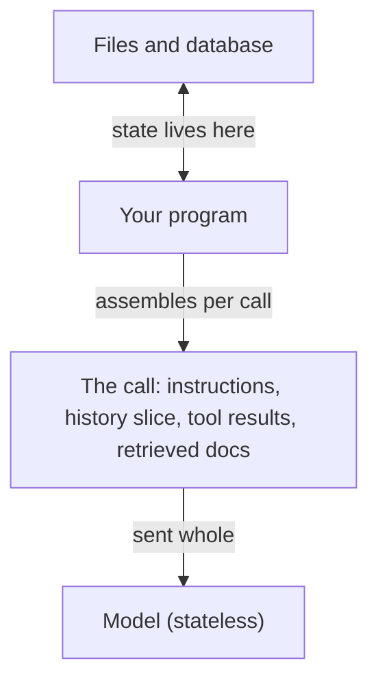

**The idea in one line:** a model remembers nothing between calls. Everything it seems to know, your program handed it again.

A model has no memory of you. It doesn't recall your last question, your name, or what it said a minute ago.

If it seems to, something handed all of that back in the same call, as text.

**State** is the facts a system is carrying right now: what has been said, what has been done, what is still pending. The model carries none of it. Each call is a fresh start, so whatever it should know travels with the request, every time.

So your program does the remembering. A chat app keeps the conversation in a list and sends the whole list on every turn, plus the new message.

An **agent** is the same idea with more parts. Before each call, it assembles a bundle:

- instructions
- relevant history
- results from tools it has run
- any retrieved documents

Then it sends the bundle and reads the reply.

Here's the analogy. Picture a desk clerk who wakes each morning with complete amnesia. He is skilled and sensible, but he knows only what is on the desk in front of him.

A clear briefing sheet, yesterday's relevant notes and the two files he needs make his day good. Forty irrelevant folders make him slow and muddled. A missing key file makes him guess. The clerk is the model, and you lay out the desk.

That job has a name: **context engineering**. For every call, you decide what earns a place in the bundle. The **context window** (the limit on how much text one call can hold) is the size of the desk, and tokens are what you pay each time you lay it out.

> Put in what the task needs and leave the rest out. Both the window and the bill push the same way.

## Real-world example: the 230,000-token call

Our enrichment pipeline asks a model to classify a company from a short description. It drives the model through a general-purpose agent runtime, a ready-made program that handles the loop of calling a model and running its tools. Nobody had looked at what that runtime put on the desk by default.

By default, every call carried the runtime's full toolbox and boilerplate instructions: about 230,000 tokens per call. The classification needed under 2,000.

A handful of configuration flags stripped out everything the task didn't use. The same work ran at roughly 1,900 tokens per call, over 100x smaller, with identical answers. We had been billed for the rest on every call, for every row, until someone asked what was actually in the call. The fix took minutes.

## See it yourself (2 minutes)

Open any AI chat. Start a brand new conversation and ask:

> What did I ask you five minutes ago?

It can't tell you, because nothing was put in front of it. Now paste a short note about yourself, such as a few lines on your job and a goal, and ask:

> Using only what I just pasted, write me a one-line introduction.

It works, because you supplied the state in the same call. Last, ask it to list every piece of text it can currently see in this conversation. That list is the desk. Notice how little of it you chose on purpose.

## What this means when you build

From Project 1 onward, every agent starts with one question: what goes in the call?

- List the pieces of the bundle (instructions, history, tool results, retrieved text) before writing code.
- For each piece, write why it earns its place and what happens if it's missing.
- Your prediction sheet carries a token count for the bundle. Where the real count lands far above it, look for folders nobody meant to put on the desk.

## Check yourself

Your classification task needs under 2,000 tokens, but the cost meter shows roughly 230,000 tokens per call. Where do you look first, and why can the model not be the cause?

Decide on your answer, then open

Look at what your program assembles into each call, since the model remembers nothing and only reads what is sent. In our case a general-purpose agent runtime was adding its full toolbox and boilerplate by default; stripping it out gave identical answers at over 100 times fewer tokens.

