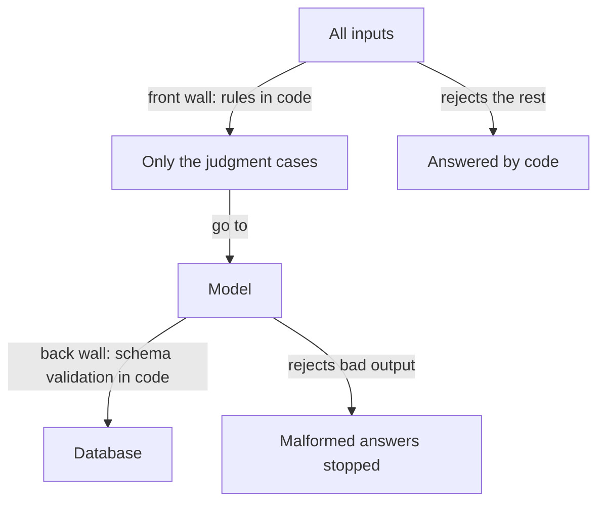

**The idea in one line:** give rules to plain code and judgment to the model. Code in front and behind keeps it safe.

Once you've seen what a model can do, the temptation is to give it everything. Is this email well formed? Is this job in a country we cover? Is the answer one of five allowed values? The model can answer all of these. The question is whether it should.

Sort your decisions into two piles:

- **Rules:** questions with a definite answer that a few lines of code compute the same way every time.
- **Judgment:** questions where the answer depends on meaning, tone or context, and no tidy rule captures it.

Rules go to code. Judgment goes to the model.

The reasons are practical:

- Code gives the same answer on every run. A model might not.
- Code finishes in microseconds. A model call takes seconds.
- Code costs effectively nothing per decision. A model call is metered in tokens.
- Code can be tested exhaustively. A model can only be sampled.

> Whenever a deterministic check can decide, a model call on top of it adds cost and risk and buys nothing.

That gives a well-built agent its shape: ordinary logic in front, the model in the middle, ordinary logic behind. The **front wall** filters, so the model only sees cases that need judgment. The **back wall** validates, so nothing the model says reaches your database or customer until code has checked it.

Here's the analogy. A restaurant kitchen has a chef, and the chef's judgment is why people come. But the chef doesn't check reservations, count cutlery, or confirm each plate's garnish. Door staff decide who gets a table. The pass, the counter where plates are inspected, decides what goes out. The chef's attention goes only where it's irreplaceable.

## Real-world example: the if-statement that answers first

Our job board processes thousands of postings a night. Before any model sees a posting, plain code decides whether it needs one: scope rules (is this a role we list?), pattern checks (does the text say "remote" unambiguously?) and eligibility gates. Thousands of rows get answered by an if-statement, which costs nothing.

Only the survivors reach the model, and its job is narrow: pick from a fixed list. Then the back wall validates the output against the **schema**, the exact shape and allowed values we defined, before anything touches the database. A malformed answer is caught at the wall, not found a week later in a customer's search results.

Most of the system's reliability lived in the walls. The model was the interesting part and the least important for correctness. For a while we paid for model calls that an if-statement could have answered free. We should have drawn the front wall first.

## See it yourself (2 minutes)

Open any AI chat and describe a small task you might automate, such as sorting support emails. Then ask:

> List every decision this system has to make. For each one, label it RULE (a few lines of code could decide it identically every time) or JUDGMENT (it depends on meaning). Then tell me which RULE decisions I might be tempted to give to a model, and what that would cost me in speed, money and repeatability.

Count how many land in each pile. Most people find the rules pile is larger than expected, and that is where the savings sit.

## What this means when you build

In Project 1, draw the two walls before you write a prompt.

- List what the front wall can answer without a model.
- Write the schema the back wall will enforce on whatever the model returns.
- When you report cost per document, say what share of inputs never reached a model, and why that share is part of your design.

Your mentor checks the walls before the prompt.

## Check yourself

A posting says "remote" in an unambiguous way. Should the model classify it, and what stops a malformed model answer from reaching your database on the postings that do reach the model?

Decide on your answer, then open

No, a pattern check in the front wall can decide that for free and identically every time. For the postings that do reach the model, the back wall validates its output against the schema (exact shape and allowed values) before anything touches the database.

