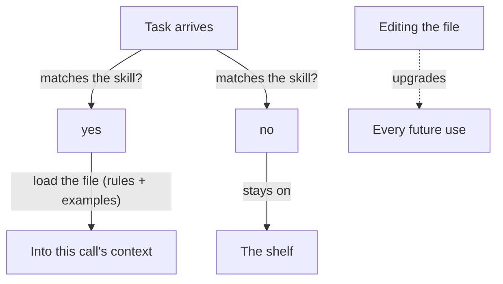

**The idea in one line:** a skill is a file of rules and examples an agent loads only when the task matches.

Say you want an agent to write outreach emails your team's way: plain, specific, no adjectives where a fact will do. The model has never met your team. You have three options.

- **Retrain the model** on your examples. This is slow, expensive, and freezes your taste into something you can't easily edit.
- **Stuff every rule into the prompt** on every call. The prompt gets enormous, the meter runs hot, and the model's attention thins out over irrelevant text.
- **Write a skill.**

A **skill** is a plain-language file that holds a way of working: the rules, plus worked examples of the rules applied to real cases. When the task matches (this is outreach drafting, so load the outreach skill), the agent reads the file into its context for that call. Otherwise the file stays on the shelf.

Why examples, not just rules? Rules state what you want in the abstract. Examples show where the boundary falls. "Keep it short" means something different once the agent has seen three emails you kept and one you cut.

Here's the analogy. A woodworking shop keeps a binder for apprentices. Each page covers one joint: the rules ("grain runs along the length, never cut across a stress point") and photographs of finished joints, good and rejected.

An apprentice starting a dovetail opens that page. Nobody retrains the apprentice, and improving the binder improves every future piece.

> Skills are how a system accumulates taste, in a file you can read, edit and review, so it outlives any single session, agent or teammate.

## Real-world example: a style guide mined from real replies

Our outreach drafts follow a written style guide, and that guide is a skill file. Each rule has real examples. One says: state pricing as a plain fact, with no adjectives. "Our affordable plans" fails. An email saying what the plan costs, relative to what the prospect pays now, passes.

The newest rules weren't invented at a desk. They were mined from months of replies the operator had sent to real prospects. Patterns that kept appearing in the replies that worked became rules, and the replies became the examples.

Any agent drafting outreach loads that one file and inherits the house judgment. So does a new teammate on day one. Nothing was retrained and no model changed.

One limit, stated candidly: a skill carries judgment only as well as its examples do, and ours reflect one operator's replies. When that operator's style shifts, the file gets revisited. That is exactly why it is a file and not a fine-tuned model.

## See it yourself (2 minutes)

Open any AI chat. Paste a short message you wrote and liked, such as an email or an announcement, and ask:

> Read this as a sample of my writing. Write me a one-page skill file for drafting messages like this: five rules, and for each rule one short example from this sample showing it applied. Then draft a new message on a topic I give you, using only that file.

Read the five rules and judge them. Which are real? Which are generic? The distance between those two is the work of building a good skill.

## What this means when you build

In Project 2 you'll write your first skill: a short file of rules with examples drawn from real data you've looked at.

- Keep it small. Five rules you can defend beat fifty you can't.
- Your mentor will ask you to point to the real example behind each rule.
- If you can't, the rule isn't ready. Writing that example down is how the rule gets earned.

## Check yourself

Which of these emails follows the skill rule "state pricing as a plain fact, with no adjectives"? (A) "Our affordable plans fit any budget." (B) "The plan costs $49 a month, against the $120 you pay now."

Decide on your answer, then open

B. A fails because "affordable" is an adjective doing the work a number should do. B states the price relative to what the prospect pays now. The rule lives in a plain file with examples, so anyone can open it and argue with it, which a retrained model would not allow.

