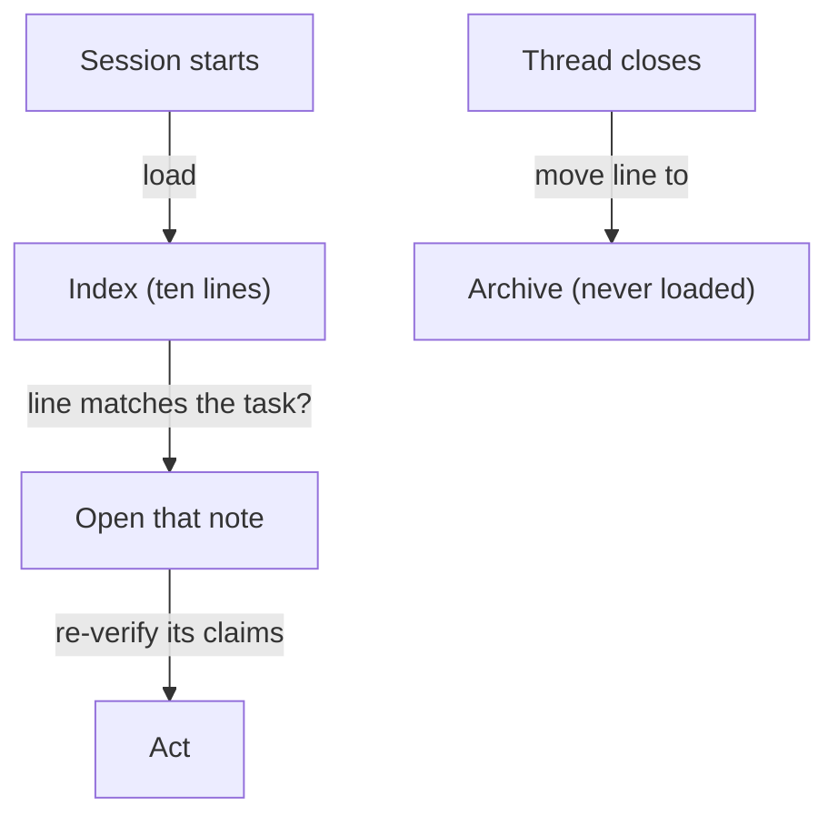

**The idea in one line:** agent memory is files it writes and reads back, and old notes are claims to re-check.

The model remembers nothing, so how does an agent pick up today where it stopped yesterday? It reads a file. Whatever it wants to know tomorrow, it writes down today, where your program loads it at the next session start.

Memory is retrieval. Nothing mysterious happens inside the model. There's a store (plain files or a database), a way of writing to it, and a way of finding the right parts for the next call.

The structure that works is small:

- One short **index** file, loaded every session.
- Each index line points to one **note** file about one open thread of work.
- A note is read only when its line matches what the agent is about to do.

That keeps the daily cost low, in the same spirit as the skills from the previous note.

Here's the analogy. A library doesn't put every book on your desk. It gives you a card catalogue: short entries saying what each book covers and where it sits. You scan it, pull the two books you need, and leave the rest on the shelf. The index is the catalogue, and the notes are the books.

Now the part that bites. Books go out of date. A note written three weeks ago described the world three weeks ago, and an agent that treats it as fact will act on things that stopped being true.

> Memories are claims to re-verify, not facts to trust. Stale memory is worse than no memory, because it arrives with the confidence of something written down.

## Real-world example: ten lines the agent reads every morning

Our own agent keeps a small index file, loaded at the start of every session and capped at roughly ten lines. Each line points at one note for one open thread: a build in progress, a decision waiting on someone, a launch held for review.

Three house rules keep it honest:

- **Closed threads move to an archive that is never loaded**, so finished work stops costing attention.
- **The cap forces eviction.** Adding an eleventh line means choosing which line goes. Without the cap, an index grows until the agent reads more history than work.
- **Old notes are claims to re-verify.** If a note names a flag or a file, the agent checks it still exists before acting.

The third rule came from being wrong. A note can name a setting that was later renamed, or a file that was moved, and an agent that trusts it works confidently from a map of a place that has changed. The check costs seconds. The mistake can cost an afternoon of work built on something that was gone.

## See it yourself (2 minutes)

Open any AI chat. Describe three things you're working on, a sentence each, then ask:

> Turn this into a memory system for an assistant that starts every session knowing nothing. Give me an index of at most five lines, and one short note file for each thread. For each note, add a line saying what the assistant should re-check before trusting it.

Look at the "re-check" lines. Each is a place where yesterday's fact could be stale by tomorrow. Which would hurt most?

## What this means when you build

In Week 7 your agent runs across more than one session, so it needs memory before anything fancier. Build the smallest version:

- an index with a hard cap
- one note per open thread
- an archive for closed ones
- a habit: every note that names something checkable gets checked before it drives an action

A good test starts your agent cold with only its memory files in place. That is the quickest way to learn whether what it wrote down is useful or merely long.

## Check yourself

Your agent's memory note says "use the --fast flag." Do you act on it straight away or check first? Say what you check.

Decide on your answer, then open

Check first. A note is a claim from the past, and the flag may have been renamed or the file moved since. Confirming the flag still exists takes seconds, while building on a map of a changed place can cost an afternoon.

