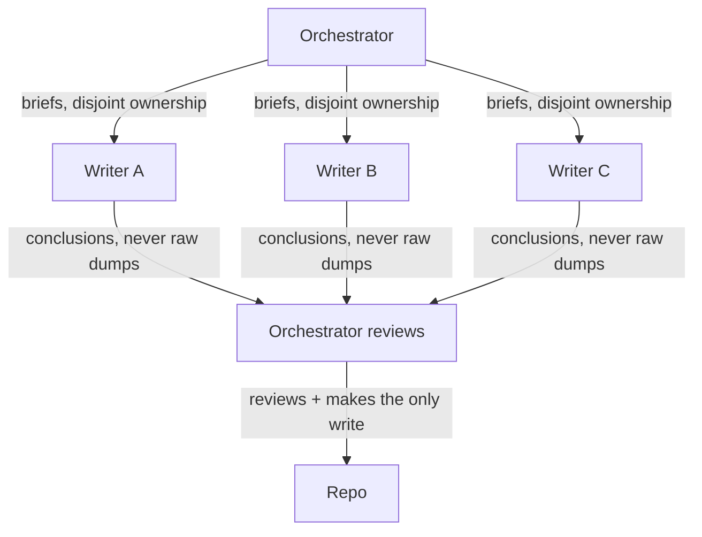

**The idea in one line:** extra agents add coordination cost. Split only when contexts shouldn't mix or work divides cleanly.

Once one agent works, it's tempting to build five. But every extra agent is another desk to set up, another bundle to assemble, and another place where work can overlap or fall through a gap. **Coordination** is a real cost that grows with every agent. So ask when a split pays for itself, never how many agents you can run.

There are two good reasons.

**1. Contexts shouldn't mix.** Say you need research on twenty companies. One agent would fill its single desk with twenty piles of raw pages, and its judgment would blur. Instead, each company goes to a separate agent that reads the raw material and returns a short conclusion. The parent gets conclusions, not dumps.

**2. Work parallelises on disjoint ownership.** If the job divides into parts that don't touch, several agents can run at once. **Disjoint** means each agent owns a set of things, no two sets overlap, and no agent edits what another owns. Two agents writing the same file at once is how you lose someone's work.

Someone still has to own the whole. That is the **orchestrator**: the agent or person who hands out work, reviews what comes back, and makes the final write.

> The helpers draft. The orchestrator decides what is actually used.

Here's the analogy. A building site hires subcontractors: one crew for plumbing, one for electrics, one for the roof. Each works its own part and doesn't rewire another's circuits. The general contractor walks the site, inspects every crew, and signs off. Remove the contractor, or let two crews rework one wall, and the site descends into rework and argument.

## Real-world example: how these notes were written

The notes you're reading were drafted by four agents running in parallel in one shared project folder. Three rules made it work:

- Each agent owned a strictly disjoint set of files, so none could overwrite another's work.
- None ran version-control commands (the tools that record and merge changes), so none could tangle the project's history.
- One orchestrator reviewed everything and made every commit.

We learned this the hard way. An earlier approach gave each agent its own copied workspace, and a copy can start from stale code, so an agent works on a version of the project that has already moved on. Disjoint ownership inside one live checkout removed that risk.

One more detail. Partway through, one agent was redirected because a decision changed while it worked. That was coordination working as intended. The orchestrator held the whole picture, so it could change one agent's course without disturbing the other three.

## See it yourself (2 minutes)

Open any AI chat. Think of a project with several parts, such as planning an event or writing a five-section report. Ask:

> I want to split this project across several AI agents. For each agent, list the exact files or sections it owns and what it must not touch. Then tell me: which parts truly need separate agents because their contexts should not mix, and which are cheaper to leave with one? Be honest about the coordination cost.

Check whether any two ownership lists overlap. Wherever they do, work would collide.

## What this means when you build

In the capstone you'll justify each split.

- Write down which of the two reasons applies and what the split saves, then set it against the coordination cost. If you can't name the saving, keep one agent.
- When you do split, assign disjoint ownership, name the orchestrator, and decide who makes the final write before any agent starts.

A smaller design you can explain beats a larger one you can't.

## Check yourself

You want to research twenty companies with several agents. Which of the two good reasons to split applies, and what should each helper hand back to the parent?

Decide on your answer, then open

Contexts shouldn't mix: one agent would fill its single window with twenty piles of raw pages and its judgment would blur. Each helper reads its own company and returns a short conclusion, so the parent gets conclusions, not dumps, and the mess stays where it was made.

