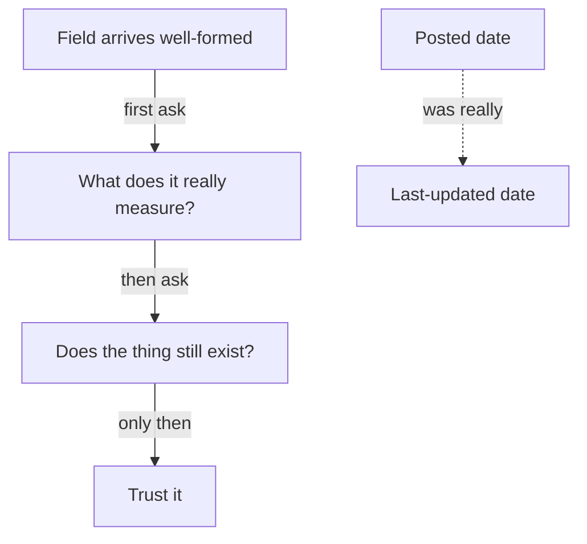

**The idea in one line:** a field can be present, well formed and wrong. Check what it means and whether it still exists.

Demo data is written by someone who knows what the answer should be. Every date is a date, every record is current. Real data is written by thousands of people and programs in a hurry, none of them thinking about you.

Typos and blanks are the easy kind of mess, because you can see them. The dangerous kind looks perfect. A field is present, correctly formatted, in the right column, and quietly means something other than its label says. Call that a lie, with the understanding that nobody meant it.

Data lies in two layers:

- **What the field means.** Does the label match what it measures?
- **Whether the thing it describes still exists.** Is the record still true today?

Here's the analogy. A property listing says "Recently renovated. Available now." The photos look great. But they're six years old, the "recently" was the previous owner, and the flat was rented out in spring with nobody taking the listing down.

Each statement was true on some day. The listing as a whole is out of date and never says so, because it can't notice that time has passed.

> None of the fixes trusted the data harder. Each one went and checked.

## Real-world example: the date that lied and the jobs that lingered

**Layer one is the field itself.** Our job board needs each posting's age, so we read the "posted" date. One applicant-tracking system (the software companies use to manage job applications) reports it faithfully, in the right format, on every job. But the value is when the job was last updated, not when it was posted. Fix a typo in a posting from last spring and it is suddenly "posted" yesterday.

So a stale job looks fresh, and the more a company tinkers with an old listing, the fresher it looks. No error, no blank. You only catch it by knowing what the system really means by those words.

**Layer two is the thing the field describes.** Employers rarely close a posting once the role is filled. We found job posts seven to eleven months old still marked live, long since hired for or abandoned. A job seeker applying to one would be writing into nothing.

We made three fixes, each doing a different job:

- Every night we re-verify that a posting is still there.
- Postings that have been up a long time carry an "Open N+ months" badge, so a reader can judge.
- Our outreach is forbidden from using any posting older than 45 days, so a stale record can't leak into a message to a real person.

## See it yourself (2 minutes)

Ask your agent or any AI chat to build the trap for you:

> Generate 12 rows of fake job-listing data as a table with columns: title, company, location, posted_date, status. Make it look like a real scraped dataset, with at least four realistic problems hidden in it that a careless reader would miss. Do not tell me what they are yet. Then, I'll try to find them, and you tell me how many I got.

Hunt for a few minutes before asking for answers. Then ask: "For each column, what question should I ask before I trust it?" The questions look similar every time: where did this value come from, what does it actually measure, and how would I know if it were out of date?

## What this means when you build

Your Week 5 pipeline runs on a deliberately awkward dataset: some fields fine, some blank, some confidently wrong.

- Before writing a prompt, write one line per column: what the field claims, what it might really mean, how you'll check.
- Add a freshness check, because anything you keep long enough goes out of date.

A pipeline earns trust by verifying what it could have assumed. That habit is cheap on day one and very expensive to add later.

## Check yourself

A job posting is nine months old but the source still says it is live. Can your outreach use it? Answer yes or no and give the rule.

Decide on your answer, then open

No. Outreach is forbidden from using any posting older than 45 days, because employers rarely close a posting once the role is filled and a stale record would reach a real person. The fixes all go and check instead of trusting the data harder.

