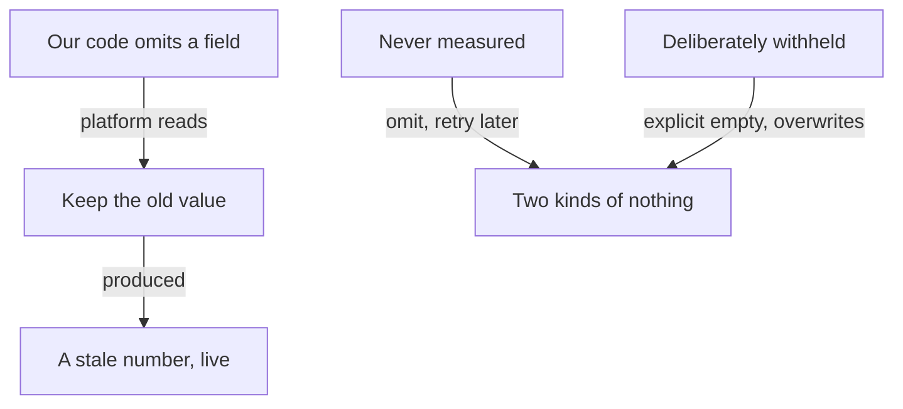

**The idea in one line:** two systems can each be correct and still wrong together, because they assume different things.

Most bugs live inside one program: a wrong line, a missing check. Integration bugs live somewhere stranger. System A works. System B works. Each passes its own tests.

Connect them and the output is wrong, because A and B hold different, unspoken beliefs about what a word, number or setting means.

Nothing crashes, and that makes these bugs expensive. A crash announces itself. A quiet disagreement produces plausible output, which people then act on.

Here's the analogy. A ship's navigator has two compasses, both in good working order. One points to true north, the fixed spot at the top of the globe. The other points to magnetic north, which sits elsewhere and slowly wanders.

Plot a course with one and steer by the other, and every reading looks reasonable while the ship drifts off the chart. Neither compass is broken. The mistake is assuming "north" means one thing.

> Tests that check only that a value looks fine miss the join. Check that the key is actually present in what you send.

## Real-world example: the stale number that shipped on day one

Our email-sequence system sends follow-ups to real leads and fills each template from per-lead data: a name, a company, a figure relevant to that lead. Sometimes we never managed to measure a field for a lead. Then our code left it out of the update it sent to the sending platform. Nothing to say, so say nothing.

The platform has its own natural rule, written into its contract: a field omitted from an update means "keep whatever value you had before". Both behaviours were reasonable. Together, when our code said nothing, the platform kept an old figure and used it.

A stale dollar figure went live on a real lead the very day the feature shipped. Our code worked, the platform worked, and the assumption between them, that "omitted" means "nothing", was wrong. The email looked normal, so nothing flagged it.

The fix began by splitting "nothing" into two kinds:

- **Never measured:** we don't know, so we omit the field and try again later.
- **Deliberately withheld:** we know we shouldn't say it, so we send an explicit empty value that overwrites whatever was there.

The tests changed too. They now check that the key is present in what we send, rather than only that the value looks fine.

A second case has the same shape. A people-search API offers two similar filters, `company` and `current_company`. The obvious one, `company`, quietly includes people who left years ago. Neither errors, and both return tidy lists of real people.

## See it yourself (2 minutes)

Give your agent or any AI chat this:

> Give me five examples of two software systems that each work correctly on their own but give wrong results when connected. Make them concrete: name the shared word or assumption they disagree about. For each, give a one-sentence test I could run that would catch it.

The proposed tests almost all share a form: take a case where you already know the right answer, send it through the whole chain, and compare. That one habit finds this whole family of bugs, because it checks the join rather than either side alone.

## What this means when you build

In Week 5 you'll connect pieces you didn't write: a data source, a model, a tool. Each connection is a place where two parties may use the same word differently.

- Before trusting any join, run it on three cases you already know the answer to, including one that should come back empty.
- For every integration, add a line to your project notes: "A says X, B reads it as Y."

If you can't fill in both halves, you haven't finished reading the documentation. Better to learn that now than after the first real run.

## Check yourself

Your code omits a lead's dollar figure because it was never measured. The platform's contract says an omitted field keeps its previous value, and the lead had $4,200 stored from earlier. What goes into the email, and what should the code send for a figure you deliberately withhold?

Decide on your answer, then open

The stale $4,200, because "omitted" means "keep what you had" to the platform. For "deliberately withheld" the code must send an explicit empty value that overwrites it, and tests should check the key is present in what is sent, not only that the value looks fine.

