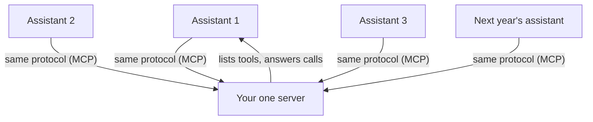

**The idea in one line:** a shared protocol lets any agent use any tool, with no custom connection for each pair.

The API note covered the contract between two programs. It left a problem open. An agent using ten tools needed ten hand-built connections, each breaking in its own way.

A tool-builder who wanted every AI assistant to use their tool had to build a separate integration for each assistant, and keep them all working forever.

The fix is the same move that fixed APIs: agree on a standard. **MCP** (Model Context Protocol) is a shared convention for how an agent discovers and calls tools.

A tool-builder publishes an **MCP server**, a program that announces to any connecting agent: "here are my tools, here is what each takes, here is what each returns." Any agent that speaks the protocol can read the list and start calling. Neither side has heard of the other, and nothing custom gets written.

Here's the analogy. Before shipping containers, every port transfer was custom: barrels rolled, sacks carried, crates craned one shape at a time, every ship-to-train handoff negotiated by hand. The container settled one question, the shape of the box. Suddenly any crane could lift any cargo from any ship onto any train.

Nobody standardised what goes inside the box. MCP standardises the box: how tools are listed, called and answered. What your tools do stays entirely yours.

> A protocol turns your work from an integration into a product. A tool published as an MCP server can be used by agents that did not exist when you built it.

## Real-world example: one server, every assistant

Our job board is published as an MCP server. We wrote it once: tools for searching jobs, filtering by what matters to a candidate, and reading a posting's details.

Then assistants made by different companies connected, and we wrote nothing extra for any of them. When a new assistant appears next quarter, it can use our board on launch day, and we do nothing to make that happen.

Without the protocol we would have built two integrations grudgingly and said no to the rest. The protocol is why saying yes costs nothing.

One honest caveat. A tool any stranger's agent can call is a public door, so everything from the earlier notes applies at once:

- rate limits, so one caller can't drown the rest
- careful thought about what needs a logged-in identity
- clearly written tool descriptions, because the only "user interface" your server has is the words an agent reads to pick a tool

## See it yourself (2 minutes)

In any AI chat, paste this:

> I run a small library. Design the tool list for an MCP-style server that AI agents could use: 4 tools, and for each a name, what it takes, what it returns, and a one-sentence description written so an agent picking tools would use it correctly. Then show me one bad description that would make an agent call the wrong tool, and explain why.

The last part is the lesson working. A description is the exact text another model reasons over, and a vague sentence there produces wrong calls the way a vague prompt produces wrong answers.

## What this means when you build

Your capstone is this move: one of your agents, packaged as an MCP server a stranger's agent can use cold. Our harness will be that stranger. It connects with no help from you, reads your tool descriptions, and attempts real tasks.

Success depends on a clean tool list, descriptions written for a reasoning reader, and limits that keep one caller from spoiling it for the rest. When it works, you've shipped what employers mean by "built with AI": a capability other systems can rely on.

## Check yourself

A new assistant from another company launches next quarter. What do you have to build for it to use your MCP server, and which text on your server will it rely on to pick the right tool?

Decide on your answer, then open

Nothing, because the new assistant speaks the same protocol and reads your tool list on its own. It decides which tool to call from your tool descriptions, so a vague description there leads to wrong calls the way a vague prompt leads to wrong answers.

