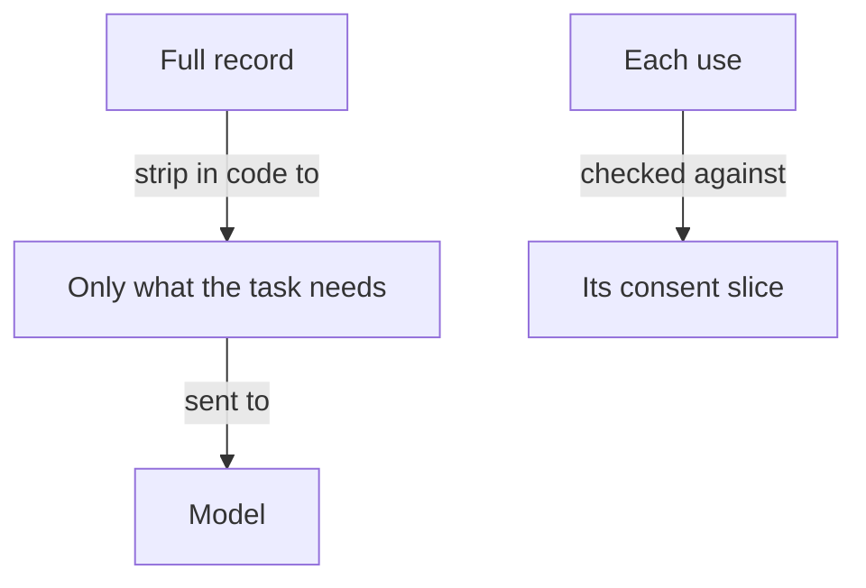

**The idea in one line:** anything in a prompt has left the building. Send the model only what the task needs.

When you give a model some text, that text travels. It leaves your computer, crosses the internet to a provider, and is processed on machines you don't control. Depending on the provider's terms it may be logged for a while.

And whatever the model sees, it can repeat: in its answer, in a summary, in a draft email to someone else.

So the first question for any AI system is cheap: does the model need this to do the job? Sending only what the task requires is called **data minimisation**. It is the most effective privacy measure available, because it works before anything goes wrong.

> Data that never entered the prompt can't be logged, leaked or repeated.

The data most worth guarding is **PII**, personally identifiable information: anything that identifies a real person, such as a name, email address, phone number, employer or CV.

Here's the analogy. When you hand a valet your car, you can hand over a valet key. It starts the engine and turns the wheel, but doesn't open the boot or the glove box. The valet needs to park the car, so the valet gets exactly that access.

That is the ordinary way to hand something you care about to someone you don't know well, and models fit that description: capable strangers.

## Real-world example: consent in three slices

Deployed holds candidate profiles, and a profile is full of personal data. Early on we had to decide what a candidate agrees to. The tempting version is one big checkbox: "I agree." We didn't build it.

Candidates consent in separate slices:

- **Job matching:** we may compare their profile to openings.
- **Email alerts:** we may write to them.
- **Sharing with employers:** a company may see who they are.

Nobody grants everything at once, and granting one slice does not quietly grant another. Someone who wants matches but never wants an employer to see their name can have exactly that.

Each part of the system asks "which slice covers what I'm about to do?" before it touches the data, the way the valet key limits what the car can do. A part that only does matching should have no reason to see contact details at all.

The same instinct sets a rule worth copying. Keep your own accounts and personal data out of your test runs. Point your agent at sample data and a sandbox, so a bug can't leak what it never held.

## See it yourself (2 minutes)

Make up a customer record. Invent everything: a name, an email, a phone number, an order history and a complaint. Paste it into any AI chat with this:

> Here's a fictional support ticket. My task is: classify the complaint as billing, delivery, or product quality. Which fields do you actually need to do that? Which would I strip out before sending anything to a model? Rewrite the ticket with only what the task needs.

Compare the two versions. Usually the task needs a sentence or two of the complaint and nothing else. Then ask: "What could go wrong if the stripped fields had been included?" The answer is a list of things you now avoid by default.

## What this means when you build

In Week 7 your system touches material that belongs to someone.

- Before any prompt, make a two-column list: what the task needs, and what's merely nearby.
- Only the first column goes to the model. Strip the rest in your own code before the request is sent. Asking a model to ignore something it can see is a request. Stripping is a guarantee.
- For each action your system takes, write down which permission covers it. If you can't name one, the action doesn't happen yet.

## Check yourself

A candidate consented to job matching and email alerts only. An employer-facing page wants to show their name. Allowed, yes or no? Which slice would have covered it?

Decide on your answer, then open

No. Consent is given in separate slices and granting one does not quietly grant another. Only the "share with employers" slice covers it, and each part of the system should ask which slice covers what it is about to do.

