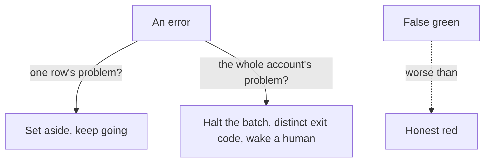

**The idea in one line:** skip a bad row and keep going, but halt on a broken account. Never report false green.

Every system fails. The design question is how: what the system does in the thirty seconds after something goes wrong, and what it leaves for the humans who arrive later.

Start with a distinction that governs everything. Some failures belong to one piece of work: a malformed document, a posting in a language your prompt can't handle, one row that times out. These are **row-level failures**. Others belong to the whole operation: an expired key, an exhausted account, a provider outage. These are **account-level failures**.

The two deserve opposite treatment:

- **Row-level:** set the row aside and continue. One bad document says nothing about the next.
- **Account-level:** stop everything immediately. Every later row will fail for the same reason, and each attempt costs time, money, or both.

Here's the analogy. A cashier who finds one counterfeit note sets it aside and serves the next customer. A cashier whose card machine loses its connection closes the lane, because swiping the next hundred cards won't fix the network.

A cashier who kept swiping, bagging a "declined" slip into each customer's shopping, would be absurd. Software does this absurd thing by default.

> Honest red is cheap. False green compounds.

## Real-world example: the night of 8,402 errors

One night our enrichment pipeline was working through a large backlog of job postings. Partway through, the model provider's account hit a payment problem and every request came back with the same answer: payment required.

The pipeline treated each identical response as a row-level failure. It wrote an error against the row, moved on, and tried the next. By morning it had logged 8,402 per-job errors, each attempt taking its time, each writing a failure against a row with nothing wrong with it.

Then it exited with the success code. The scheduler saw green. Nothing paged anyone.

Count the costs:

- The wasted hours were the small one.
- 8,402 healthy rows were marked failed and had to be found and cleaned, a chore that is easy to get wrong.
- Worst was the checkmark. A system that reports success while failing completely trains its operators to trust a signal that means nothing.

The fix was structural. Account-level errors became their own category: the first one halts the entire batch, writes no error rows, and exits with a code meaning "the account is broken", distinct from "some rows failed" and from "all fine". The scheduler can tell the three apart, and humans get woken only for the one worth waking for.

## See it yourself (2 minutes)

Give your agent this prompt:

> My pipeline processes 10,000 documents through a paid AI service. Here are four things that can go wrong: one document is corrupted; the service's prices changed and my account ran out of credit; the service is down for an hour; my output database rejects one write. For each: should the pipeline skip and continue, pause and retry, or stop entirely? What should it report in each case?

Compare its answers with the cashier. Anywhere it says "log the error and continue" for an account-level problem, you've found the 8,402-row bug waiting to be written.

## What this means when you build

Your Project 2 pipeline is graded on exactly this. The harness breaks things on purpose and watches what your system does next.

- A pipeline that fails loudly, early and cheaply, with an exit status that tells the truth, scores higher than one with better accuracy and a lying checkmark.
- In your prediction sheet, predict your failures too: which you'll absorb, which will stop you, and how you'll know which happened.

## Check yourself

The model provider starts returning "payment required" on the very first request of a 10,000-row batch. After that first response, how many rows should be marked failed, and what should the exit signal say?

Decide on your answer, then open

Zero rows. An account-level error is not the rows' fault, so the first one halts the whole batch and writes no error rows. It exits with a code meaning "the account is broken," distinct from "some rows failed" and "all fine", so the scheduler can wake a human instead of showing false green.

