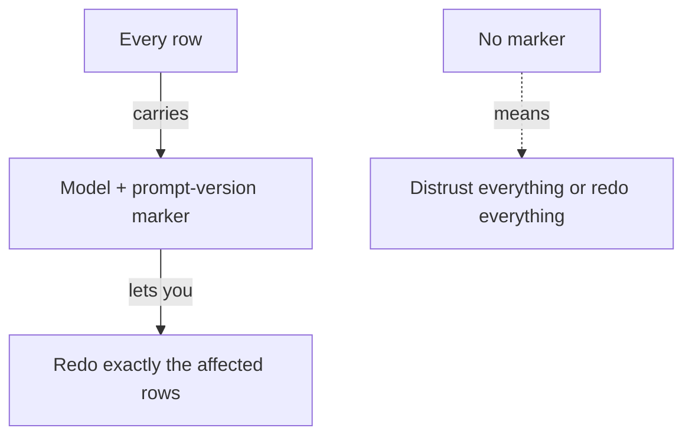

**The idea in one line:** write down what made each result, so a mistake costs a small redo, not a full one.

Sooner or later someone will point at an answer your system produced and ask three things. Where did this come from? Who or what decided it? Is it the only one like it?

A system that answers quickly has an **audit trail**: a written record, made at the time, of what happened, what did it, and under whose authority.

Audit trails have a reputation as paperwork for lawyers. For an AI system they are a repair tool. Models get replaced, prompts get rewritten, and mistakes surface weeks later. Whether you fix a small group of records or distrust the whole database depends on what you wrote down while the work happened.

Two ideas make this concrete:

- **Attribution:** every action traces to something specific, such as a person, a program or a version. It answers "who approved that?"
- **Provenance:** every piece of data carries the story of how it was made. It answers "where did this come from?"

You want both.

Here's the analogy. Food manufacturers print a lot code on every package. It looks like clutter. But when a supplier finds one batch of flour contaminated, the code is the difference between recalling three specific batches and pulling every product off every shelf in the country.

> Without the code, the only safe move is to pull everything.

## Real-world example: the marker on every row

Our database holds enriched job rows: the original posting plus things a model worked out, such as whether it's really remote and who can apply. Different rows were produced at different times, by different models, with different versions of the prompt.

So every enriched row carries a marker saying which model produced it and which prompt version was used. It is one small field, filled in at the moment the row is written. Nobody has to remember it later.

Here is what that buys:

- If one model misreads a certain kind of posting, we list exactly the rows it produced and redo only those.
- If a prompt version has a flaw, same thing.
- When someone questions a single answer, we trace it: this row, this model, this instruction, this day.
- We can compare models fairly, because we can tell their rows apart.

Without the marker, every row looks equally suspect, and the choice is between trusting all of them and redoing all of them. That is the flour recall with no lot codes.

## See it yourself (2 minutes)

Ask your agent or any AI chat:

> I'm building a system where an AI summarises customer emails and stores the summary in a database. Six months from now someone will ask "why did the system say that about this customer?" Design the minimum set of fields I should save with each summary so I can answer. For each field, tell me which specific question it answers.

Then delete fields one at a time and ask which question you can no longer answer. Most people keep five or six fields, mostly cheap ones: a model name, a prompt version, a timestamp, an input id.

## What this means when you build

In Project 4 your system acts in the world, and some actions need a human to say yes. Build the paper in from the first run.

- Every row your system writes gets a marker for what made it.
- Every approval is written down with who gave it, when, and for which specific item. "Approved" with no name can't be checked later.

You'll be graded on a drill: we name a row, and you say how it was made, who allowed it, and which other rows share its origin. It takes seconds if you wrote the trail when it was cheap, and days if you didn't.

## Check yourself

You find a flaw in prompt version 3, which produced 2,000 of your 20,000 enriched rows. How many do you redo if each row carries a model and prompt-version marker, and how many if none do?

Decide on your answer, then open

2,000 with the marker, because you can list exactly what version 3 produced. Without it every row looks equally suspect and the choice is between trusting all 20,000 or redoing all 20,000. It is the flour recall with no lot codes.

